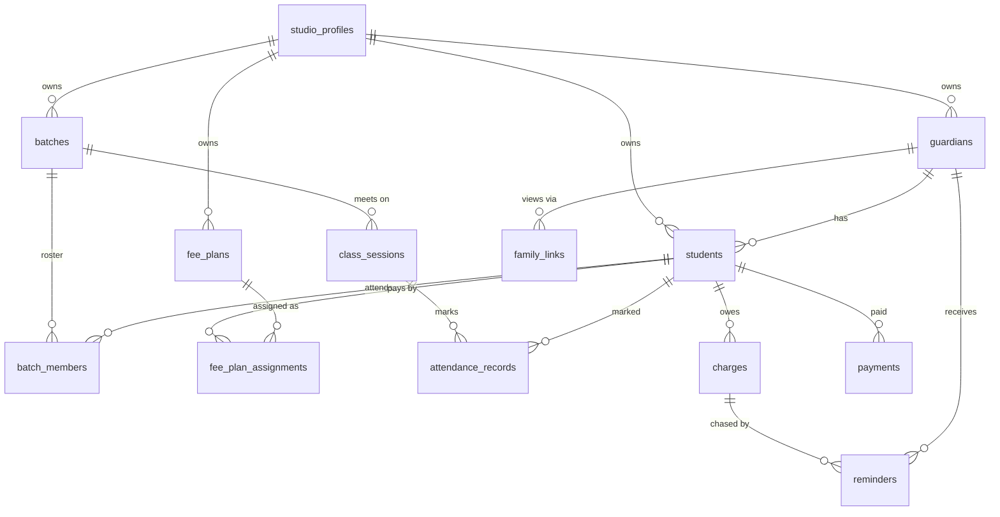
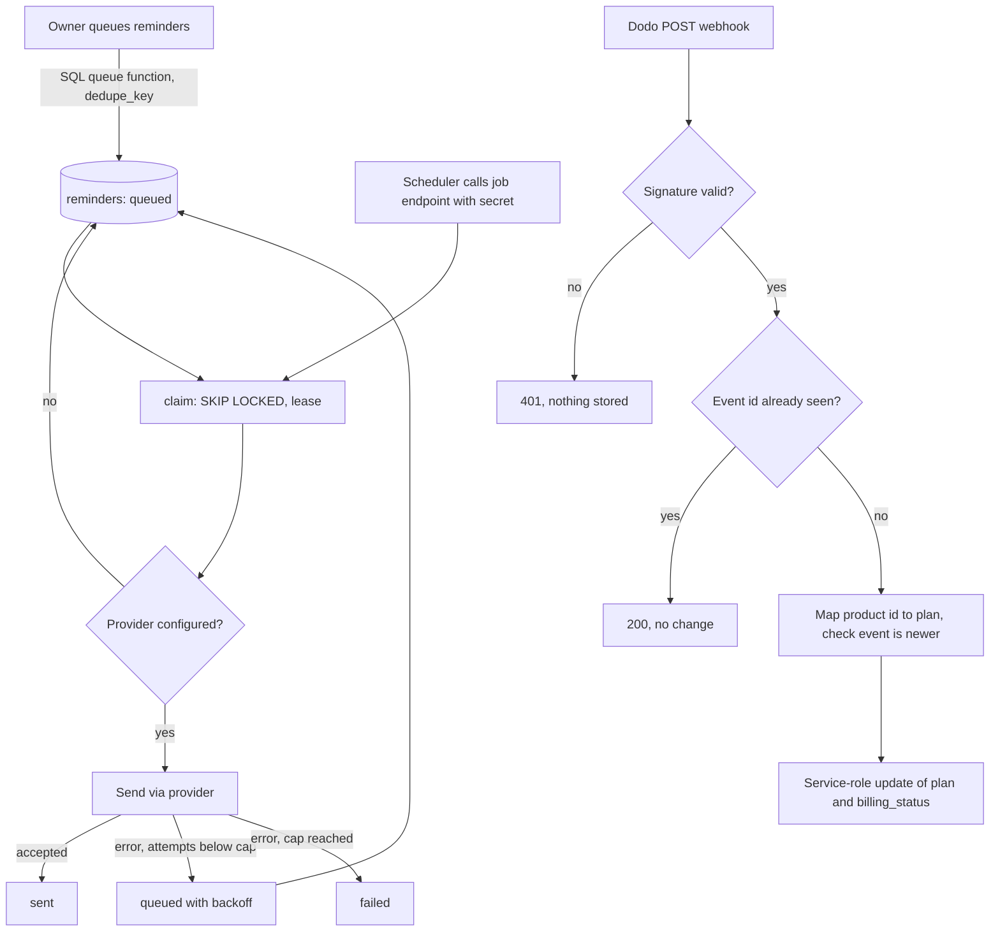

# ChoreoStudio Studio Operations Backend - Plan

## Goal Capsule

- **Objective:** A dance-studio owner can run fees, attendance, batches and parent reminders from ChoreoStudio, a family can check its own balance from a private link, and a studio's subscription activates automatically after it pays.
- **Means:** Supabase tables with row-level security, ledger rules written as SQL functions, and thin validated TanStack server functions on top (KTD4).
- **Authority:** Product Contract requirements win on behavior, Key Technical Decisions win on mechanism, units override neither.
- **Stop conditions:** Stop and report if a migration would alter or drop an existing table or column outside the additions in U4, or if signature verification of Dodo webhooks cannot be shown to work against a build.
- **Execution profile:** Implemented by `ce-work` under `lfg` in return-to-caller mode; the caller reviews, commits and pushes. Applying the migrations to the live database is not part of execution: the caller does it after the SQL has been reviewed (U12). The dashboard UI is not part of this plan.

---

## Product Contract

### Summary

Add the backend the README and the dashboard mock describe: students and guardians, batches with rosters, per-student fee plans, a charges-and-payments ledger, attendance, WhatsApp fee reminders with a retry-safe job, a private family view, and the Dodo webhook that turns a paid checkout into an active studio plan. Student money stays ledger-only.

### Problem Frame

Today the app has a waitlist, studio accounts and a subscription checkout, and nothing a studio can actually run. The `studio_profiles` table exists, but no table holds a student, a fee or an attendance mark, and a studio that pays through Dodo stays on "waitlist / not started" forever because nothing reads the payment. The landing page promises "Less chasing. More dancing." and the backend must make that true: know who owes what, remind the right guardian once, and let that guardian see the same numbers.

### Requirements

**Directory and roster**

- R1. An owner can create, edit and archive students and guardians; one guardian can have several students.
- R2. An owner can create and edit batches (name, weekly schedule, trainer, room) and add or remove students from a batch's roster, with join and leave dates kept.
- R3. An owner can define fee plans and give each student exactly one active plan at a time, independent of which batches the student attends.
- R4. A studio sees only its own records, and no row can reference another studio's records, even through a server bug.

**Fees and ledger**

- R5. Generating charges for a month creates one charge per student with an active plan that month, and running it again creates nothing new.
- R6. A charge keeps the plan name and amount that created it; later plan or price changes never alter it.
- R7. An owner can record payments the studio received outside ChoreoStudio (cash, UPI, bank transfer, other) with date and note, and a repeated submission of the same payment is recorded once.
- R8. A wrong charge or payment is corrected by voiding it with a reason; nothing is deleted.
- R9. Each student's month shows paid, due or overdue and the amount outstanding, computed by applying payments to the oldest charges first; a charge is overdue once its due date has passed in India time.
- R10. An owner can see, for a month, total billed, collected and outstanding, how many students are pending and how many overdue, and the list behind those counts.

**Attendance**

- R11. An owner can mark each student present or absent for a batch on a date, change the mark later, and read a batch's day or a student's history.

**Reminders**

- R12. An owner can queue WhatsApp fee reminders for students with due or overdue charges; a guardian gets at most one reminder per charge per day, and a guardian who opted out gets none.
- R13. Sending runs as a background job that retries failures with growing delays up to a cap, then marks the reminder failed, and a worker that dies mid-send does not lose the reminder.
- R14. Every reminder shows its status, attempts and last error, and ChoreoStudio never shows a reminder as sent unless a provider accepted it.
- R15. The messaging provider sits behind one interface so a vendor can be chosen later without touching reminder logic.

**Family view**

- R16. An owner can create and revoke a private link per guardian; the link shows only that guardian's students' upcoming classes, attendance, charges, payments and balance.
- R17. The family view is read-only, exposes nothing about other families or studio internals, and the link cannot be guessed or recovered from stored data.

**Studio subscriptions**

- R18. A verified Dodo webhook sets a studio's plan and billing status; unsigned or forged requests are rejected, and duplicate or out-of-order events never move a studio backwards.
- R19. Plan and billing columns are changed only by server code with elevated rights; an owner cannot change them.
- R20. A studio whose subscription ended can subscribe again; one with a live subscription cannot start a second.

**Cross-cutting**

- R21. No service-role key, job secret, Dodo secret or provider token reaches the browser bundle.
- R22. Every server function and every rule that decides who can see or change a row has automated tests.

### Key Decisions

- **Student money is ledger-only** (session-settled: user-directed — chosen over processing student payments through Dodo or a UPI gateway: out of MVP scope and compliance-heavy). Governs R7, R8, R9.
- **Plan and billing state is server-managed** (session-settled: user-directed — chosen over letting authenticated users update billing columns: an account must not self-assign plan or payment state). Governs R18, R19.
- **The platform `owner` role stays a waitlist concern** (session-settled: user-directed — chosen over client-side identity or email checks, and kept separate from studio tenancy so waitlist access is never granted by owning a studio). Governs R4.

### Success Criteria

- A new account can go from empty to a month of charges, two recorded payments, a queued reminder and a working family link using only the server functions, verified by tests against a real Postgres engine.
- Replaying any Dodo webhook ten times, or in reverse order, leaves the studio in the state the newest event describes.

### Scope Boundaries

- Out of scope: dashboard and landing-page UI wiring, the family-view page (only its data endpoint is built), CSV or photo import of students, scheduled automatic charge generation, enforcement of plan student limits, multiple staff logins per studio, advanced reports, and any WhatsApp vendor adapter beyond a generic HTTP one.
- Considered and not built: rate limiting on the family-view lookup (a 256-bit token cannot be searched; revisit if links are ever shortened); multiple guardians per student (see Assumptions); partial-payment allocation choices beyond oldest-first; family-link expiry (R16 asks only for create and revoke, and nothing would set an expiry; adding a column later is a small change if owners ask for it).

#### Deferred to Follow-Up Work

- Family-view page and its opt-out control for guardians.
- Scheduled monthly charge generation and automatic reminder cadence on Render.
- A vendor-specific WhatsApp adapter once a provider is chosen.

---

## Planning Contract

### Key Technical Decisions

- KTD1. **A studio is the owner's account.** `studio_id` on every new table is `studio_profiles.user_id`, so there is no separate studios table. A first write by an owner who has not saved a profile creates the profile row with default plan and billing values, which the existing insert policy already allows. Governs R4.
- KTD2. **Cross-studio integrity is enforced by composite keys.** Each parent table gets a unique `(studio_id, id)` and each child references `(studio_id, parent_id)`, so a batch roster row cannot point at another studio's student whatever the application does. Governs R4.
- KTD3. **Money is whole paise in integer columns** with a positive-amount check. Stored amounts are expensive to reinterpret later, so the unit is fixed now and the UI converts. Governs R5, R6, R7.
- KTD4. **Ledger and queue rules live in SQL functions called through RPC; TypeScript validates input and returns results.** Charge generation, oldest-first allocation, overview totals, reminder queueing and job claiming are SQL, so they are tested against a real engine (KTD12) rather than a mocked client. Governs R5, R9, R10, R12, R13.
- KTD5. **Ledger rows are immutable except for voiding.** `charges` and `payments` grant insert and select to the owner, update only on the void columns, and no delete. A charge stores its plan id, plan name and amount at creation. Governs R6, R8.
- KTD6. **Status is derived, never stored.** Paid, due and overdue come from a function that applies non-voided payments to non-voided charges ordered by due date then period, with "today" passed in (default Asia/Kolkata) so tests are deterministic. In R10, "pending" means a student whose month is due or overdue, so the overdue count is a subset of the pending count (matching the mock's "12 of 40 pending" list, which includes overdue rows). The status function takes an optional list of student ids so a caller using the service role can scope the computation in SQL. Governs R9, R10, R17.
- KTD7. **The reminders table is the queue, and one SQL function is the only way into it.** Owners can read reminders but cannot insert or update them: `queue_fee_reminders` runs with definer rights, a pinned search path and the studio taken from the caller's identity, so opt-out, eligibility and the daily dedupe rule cannot be bypassed with a direct insert. Workers claim rows with `FOR UPDATE SKIP LOCKED` and a lease; a claim does not count as an attempt, and the job counts an attempt only when it records a send outcome. Failures retry with exponential backoff to a fixed attempt cap, and a unique `dedupe_key` (charge, kind, India date) gives at most one reminder per charge per kind per day. Governs R12, R13, R14.
- KTD8. **The provider is an interface with a not-configured state.** With no provider configured, claimed reminders go back to queued without consuming an attempt and the job reports `provider_not_configured`; nothing is marked sent. A generic HTTP provider (URL and token from environment) is the only implementation. Governs R14, R15.
- KTD9. **Family links store a hash only.** The token is 32 random bytes, base64url, shown once at creation; the table keeps its SHA-256 and a revoked flag. The public lookup runs with the service role inside a server function and returns a fixed, minimal shape. Governs R16, R17.
- KTD10. **Webhook state comes from the verified payload, cross-checked, and an event counts as done only once applied.** The handler reads the raw body, verifies it with the SDK's `webhooks.unwrap` and `DODO_PAYMENTS_WEBHOOK_KEY`, records the event id in `billing_events` as not yet applied, and derives the plan from the subscription's product id against the three configured product ids (metadata is only a locator for the studio). It applies a change only when the event is newer than the last applied one and its subscription id matches the studio's stored subscription id; an event for a different subscription id may replace the stored one only when the stored one has ended (no stored id, or status `cancelled` with plan `waitlist`). The apply sets the event's applied flag together with the studio update. A redelivered event returns 200 untouched only when already applied; otherwise the apply runs again, and a failed apply returns a 5xx so Dodo retries. Governs R18, R19, R20.
- KTD11. **Module split follows the repo's existing pattern.** Each feature has a `*.functions.ts` (validators and `createServerFn`, safe for the client bundle) that dynamic-imports a `*.server.ts` inside the handler, as `src/lib/billing.functions.ts` does with `src/lib/billing.server.ts`. Governs R21.
- KTD12. **SQL behavior is tested with an in-process Postgres.** Migrations are loaded into PGlite with small stubs for the `auth` schema, `auth.uid()` and the `authenticated` and `service_role` roles, then assertions run as each role. PGlite is a single session, so claim behavior is tested sequentially there (a live lease is not reclaimed, an expired lease is, the limit is honored). Real two-connection concurrency is checked by one extra test that runs only when `TEST_DATABASE_URL` points at a Postgres database and is skipped otherwise; the final report says whether it ran. If PGlite cannot model another needed behavior, the fallback is catalog assertions on grants and policies plus a recorded gap. Governs R4, R13, R22.
- KTD13. **Migrations are plain SQL files continuing the existing numbering** (`0003`, `0004`, `0005`) with journal entries, additive only. The live database belongs to Lovable Cloud; the caller applies the migrations there after reviewing the SQL (U12).

### Assumptions

These are agent bets, not confirmed by the user.

- One guardian per student for now (`students.guardian_id`); siblings share a guardian row. Many guardians per student is deferred.
- Fees are due on the 5th unless the caller passes another date; the owner triggers charge generation for a month.
- India time (Asia/Kolkata) defines "today" and "overdue".
- A guardian is reachable on WhatsApp unless `reminders_opted_out` is true; the studio attests consent when it adds the guardian.
- Reminder text is rendered from structured fields at send time; message template names are placeholders until a provider is chosen.
- A cancelled Dodo subscription keeps its paid plan until it expires; only expiry returns the plan to `waitlist`.
- Existing production data is limited to waitlist rows, so additive migrations carry no backfill.

### High-Level Technical Design

Data model (all child tables also carry `studio_id`, omitted from edges for readability):

Reminder lifecycle and the Dodo webhook path:

### Risks & Dependencies

- Applying migrations to the live database cannot be undone by git; additive-only SQL, review of the SQL before the caller applies it, and the checks in U12 limit the exposure.
- PGlite may not model every Supabase behavior (KTD12); the fallback is stated there.
- Route files under `src/routes/api/` are new to this repo; U9 and U11 verify they appear in the generated route tree and in the production build before relying on them.
- At-least-once delivery means a worker that dies after a provider accepts but before it records the result can send a reminder twice; the lease keeps this rare and the daily dedupe key bounds it to once per day.
- Dodo event payload shapes are taken from the installed SDK types (`dodopayments` 2.54.2); U11 re-checks them against the version in `package.json`.
- `src/integrations/supabase/types.ts` is generated by Lovable; hand additions in U2 to U4 must match what regeneration produces, and a regeneration may overwrite them harmlessly once migrations are live.

---

## Implementation Units

| U-ID | Title | Key files | Depends on |
|---|---|---|---|
| U1 | SQL test harness | `src/test/db/harness.ts` | none |
| U2 | Directory schema | `drizzle/migrations/0003_studio_directory.sql` | U1 |
| U3 | Ledger and attendance schema | `drizzle/migrations/0004_ledger_and_attendance.sql` | U2 |
| U4 | Messaging, family and billing schema | `drizzle/migrations/0005_messaging_family_billing.sql` | U3 |
| U5 | Studio context, guardians, students | `src/lib/studio.server.ts`, `src/lib/directory.functions.ts` | U2 |
| U6 | Batches, rosters, fee plans | `src/lib/batches.functions.ts`, `src/lib/fees.functions.ts` | U5 |
| U7 | Attendance functions | `src/lib/attendance.functions.ts` | U3, U5 |
| U8 | Ledger functions | `src/lib/ledger.functions.ts` | U3, U6 |
| U9 | Reminders and job endpoint | `src/lib/reminders.functions.ts`, `src/routes/api/jobs/send-reminders.ts` | U4, U8 |
| U10 | Family links and public view | `src/lib/family.functions.ts` | U4, U8 |
| U11 | Dodo webhook | `src/routes/api/webhooks/dodo.ts` | U4 |
| U12 | Types, docs, rollout | `README.md`, `.env.example` | U5 to U11 |

### U1. SQL test harness

**Goal:** Run the project's SQL migrations in-process and assert behavior as a signed-in owner, another owner, an anonymous caller and the service role. Advances R4, R22 (KTD12).

**Dependencies:** none

**Files:**
- Create: `src/test/db/harness.ts`
- Create: `src/test/db/harness.test.ts`
- Modify: `package.json` (dev dependency on PGlite)

**Approach:**
- Build a harness that starts a fresh database per test file, creates the stub `auth` schema with `auth.uid()` reading the current request claims, creates the `authenticated`, `anon` and `service_role` roles, applies `drizzle/migrations/*.sql` in journal order, and exposes `asUser(id)`, `asService()` and `asAnon()` helpers that set role and claims for one query.
- Seed `auth.users` with the minimum columns the migrations reference.
- Keep the harness free of application code so migrations alone are under test.

**Execution note:** Prove the harness against migration `0000` to `0002` first: an owner reads only their own `studio_profiles` row, and an update to `plan` is rejected.

**Patterns to follow:** `src/test/billing.server.test.ts` for vitest structure and top-level await imports.

**Test scenarios:**
- Happy path: migrations `0000` to `0002` apply cleanly to an empty database.
- As user A, selecting from `studio_profiles` returns only A's row when A and B each have one.
- As user A, updating `studio_profiles.plan` fails with a permission error while updating `studio_name` succeeds.
- As the service role, updating `plan` succeeds.
- As anon, selecting from `waitlist_signups` returns zero rows or a permission error.

**Verification:** The harness test passes and a second test file gets an isolated database with no leftover rows.

### U2. Directory schema

**Goal:** Tables and policies for guardians, students, batches, rosters, fee plans and per-student assignments, with cross-studio integrity. Advances R1, R2, R3, R4 (KTD1, KTD2, KTD3).

**Dependencies:** U1

**Files:**
- Create: `drizzle/migrations/0003_studio_directory.sql`
- Modify: `drizzle/migrations/meta/_journal.json`
- Modify: `src/integrations/supabase/types.ts`
- Test: `src/test/db/directory.test.ts`

**Approach:**
- `guardians` (name, phone, `reminders_opted_out`, archived flag), `students` (name, optional `guardian_id`, archived flag), `batches` (name, weekday and time fields, trainer, room), `batch_members` (batch, student, `joined_on`, `left_on`), `fee_plans` (name, `amount_paise`, classes per week, archived flag) and `fee_plan_assignments` (student, plan, `amount_paise` copied at assignment, `starts_on`, `ends_on`).
- Every table has `studio_id` referencing `studio_profiles(user_id)` with cascade, a unique `(studio_id, id)`, and child tables reference parents through `(studio_id, parent_id)` (KTD2).
- A partial unique index allows one open assignment per student; a unique index allows one open roster row per batch and student.
- Row-level security on for every table; owner policies compare `studio_id` to `auth.uid()` for select, insert, update and delete; grants go to `authenticated` and `service_role` only.
- Add the new tables to `src/integrations/supabase/types.ts` in the generated style.

**Patterns to follow:** policy and grant shape in `drizzle/migrations/0000_choreo_waitlist_and_studio_accounts.sql`.

**Test scenarios:**
- Happy path: user A creates a guardian, two students sharing that guardian, a batch with both on the roster, a fee plan, and two assignments to different plans.
- User B selecting from each new table sees none of A's rows.
- User B inserting a student with A's `studio_id` is rejected by policy.
- Inserting a roster row whose student belongs to another studio is rejected by the composite foreign key even as the service role.
- A second open assignment for the same student is rejected; closing the first (setting `ends_on`) then allows the next.
- Adding a student to the same batch twice without a leave date is rejected; after setting `left_on` the student can rejoin.
- An amount of zero or a negative amount on a fee plan is rejected.

**Verification:** The directory tests pass and a new studio's rows are invisible to every other role in the harness.

### U3. Ledger and attendance schema

**Goal:** Class sessions, attendance, charges, payments and the SQL rules that generate charges and derive status. Advances R5 to R11 (KTD3 to KTD6).

**Dependencies:** U2

**Files:**
- Create: `drizzle/migrations/0004_ledger_and_attendance.sql`
- Modify: `drizzle/migrations/meta/_journal.json`, `src/integrations/supabase/types.ts`
- Test: `src/test/db/ledger.test.ts`, `src/test/db/attendance.test.ts`

**Approach:**
- `class_sessions` (batch, `session_on`, unique per batch and date) and `attendance_records` (session, student, present flag, unique per session and student).
- `charges` (student, `period` as first day of month, `due_on`, `amount_paise`, plan id and plan name snapshots, void columns, unique per student and period) and `payments` (student, `amount_paise`, method from a fixed set, `paid_on`, note, client `idempotency_key` unique per studio, void columns). Column grants allow update only on the void columns and grant no delete (KTD5).
- `generate_monthly_charges(period, due_on)`: for each student with an open assignment covering the period, insert a charge copying the assignment's plan name and amount, ignoring conflicts; return the number created. Runs with the caller's rights so row-level security applies.
- `student_ledger_status(period, today, student_ids)`: per student, charges for the period with allocated and outstanding amounts after applying all non-voided payments to all non-voided charges oldest-first, and a status of paid, due or overdue (KTD6); `today` defaults to the current date in Asia/Kolkata, and an optional `student_ids` list restricts the computation inside SQL.
- `ledger_overview(period, today)`: totals billed, collected, outstanding, the pending count (students due or overdue) and the overdue count, derived from the same function so the two cannot disagree.

**Execution note:** Start with failing SQL tests for oldest-first allocation, because every later screen's numbers depend on it.

**Test scenarios:**
- Happy path: two students on different plans in one batch get charges of different amounts for the same month.
- Running `generate_monthly_charges` twice for the same month creates charges once and returns zero the second time.
- A student without an assignment covering the period gets no charge.
- After the plan's amount changes, an existing charge keeps its original amount and plan name; the next month's charge uses the new amount.
- A payment smaller than the oldest charge leaves that charge partly outstanding and later charges untouched.
- A payment covering two charges marks the older paid first and the newer next; an overpayment shows as a negative outstanding.
- With `today` after `due_on`, an unpaid charge is overdue; with `today` before it, due; fully paid is paid.
- A voided payment stops counting toward allocation; a voided charge stops being owed.
- Inserting a payment with an existing `idempotency_key` for the same studio is rejected (the server function turns this into a no-op).
- As the owner, deleting a charge or payment, or changing its amount, is rejected; updating the void columns succeeds.
- Marking the same student present then absent for one session leaves one record, absent.
- `ledger_overview` reports pending equal to the students whose status is due or overdue, and overdue equal to the overdue subset, matching `student_ledger_status` for the same inputs.
- Calling `student_ledger_status` with a list of two student ids returns only those two students even when the caller bypasses row-level security (service role) and other studios have charges.

**Verification:** Ledger and attendance tests pass, including allocation and idempotency cases.

### U4. Messaging, family and billing schema

**Goal:** The reminder queue, family links, webhook event log and server-managed billing columns. Advances R12 to R14, R16, R17, R18, R19, R20 (KTD7, KTD9, KTD10).

**Dependencies:** U3

**Files:**
- Create: `drizzle/migrations/0005_messaging_family_billing.sql`
- Modify: `drizzle/migrations/meta/_journal.json`, `src/integrations/supabase/types.ts`
- Test: `src/test/db/messaging.test.ts`, `src/test/db/billing-state.test.ts`

**Approach:**
- `reminders` (guardian, student, charge, kind, `template_name`, structured payload, status of queued, sending, sent or failed, attempts, `next_attempt_at`, lease time, provider message id, last error, unique `dedupe_key`). Owners may select only; the service role updates; no owner insert or update grant exists (KTD7).
- `queue_fee_reminders(period, today)` runs with definer rights, a pinned search path and the studio taken from `auth.uid()`; it inserts one row per due or overdue charge whose guardian exists and has not opted out, with `dedupe_key` built from the charge, kind and India date, ignoring conflicts; returns the count queued.
- `claim_due_reminders(limit, lease_seconds)` selects due queued rows plus rows whose lease expired, locks them with skip-locked and marks them sending with a new lease, without changing the attempt count; execute is revoked from `authenticated`. The job increments attempts when it records a send outcome (U9).
- `family_links` (guardian, `token_hash` unique, `revoked_at`); owner select and insert, update on `revoked_at` only; no public policy.
- `billing_events` (event id as primary key, type, received time, applied flag, payload) with service-role-only access.
- `studio_profiles`: add `dodo_customer_id`, `dodo_subscription_id`, `billing_updated_at`, `current_period_end`, plus checks limiting `plan` to waitlist, starter, growth or studio and `billing_status` to not_started, active, past_due, on_hold or cancelled. The column-level update grant from `0001` is left unchanged, and the table-level insert grant is replaced by an insert grant on `user_id`, `name`, `studio_name`, `phone` and `city` only, so an owner cannot pre-set any server-managed column when first creating a profile (R19).

**Execution note:** Prove the claim function sequentially in the harness before building the job on it; add the env-gated two-connection check described in KTD12.

**Test scenarios:**
- Happy path: `queue_fee_reminders` queues one reminder for each due or overdue charge and none for paid charges.
- Calling `queue_fee_reminders` twice on the same day queues nothing the second time; calling it the next day queues again.
- A guardian with `reminders_opted_out` set gets none; a student with no guardian gets none.
- Called as owner B, `queue_fee_reminders` queues nothing for owner A's charges, because the studio comes from the caller's identity.
- As an owner, a direct insert into `reminders` is rejected, and so is updating a reminder's status.
- A first `claim_due_reminders` call marks the due rows sending without changing their attempt counts; a second call while those leases are live returns nothing; after the lease expires the rows are returned again.
- The claim honors its limit and skips rows whose `next_attempt_at` is in the future.
- When `TEST_DATABASE_URL` is set, two simultaneous `claim_due_reminders` calls over the same rows never return the same reminder; the test is skipped otherwise.
- As an owner, `claim_due_reminders` is rejected.
- A second `billing_events` insert with the same event id is ignored.
- As an owner, updating `billing_status`, `plan` or `dodo_subscription_id` fails; as the service role it succeeds.
- As an owner with no profile yet, inserting a `studio_profiles` row that sets `dodo_subscription_id`, `dodo_customer_id`, `billing_updated_at` or `current_period_end` is rejected, while the default-valued insert used by `src/lib/studio.server.ts` and the existing profile upsert in `src/lib/profile.functions.ts` still succeed.
- A `plan` of `enterprise` or a `billing_status` of `paid` is rejected by the check constraints.
- A family link row is invisible to another studio's owner and to anon.

**Verification:** Messaging and billing-state tests pass; existing `studio_profiles` rows from `0000` still satisfy the new checks.

### U5. Studio context, guardians, students

**Goal:** The shared studio context for every server function, then guardian and student functions. Advances R1, R4, R21 (KTD1, KTD11).

**Dependencies:** U2

**Files:**
- Create: `src/lib/studio.server.ts`
- Create: `src/lib/directory.functions.ts`
- Create: `src/lib/directory.server.ts`
- Test: `src/test/directory.server.test.ts`

**Approach:**
- `studio.server.ts` exposes one helper that takes the middleware context, makes sure the owner's `studio_profiles` row exists (insert with defaults if missing), and returns `{ supabase, studioId }`; also a small mapper from database errors (unique, foreign key, permission) to user-readable messages that never echo SQL.
- Functions: list, create, update and archive for guardians and students, each validated with Zod (name length, phone shape reused from `src/lib/profile.functions.ts`, ids as UUIDs) and protected by `requireSupabaseAuth`.
- List functions accept an optional search string, an archived filter and a page size capped at a fixed maximum.
- Archiving sets a flag; nothing is deleted.

**Patterns to follow:** `src/lib/billing.functions.ts` and `src/lib/billing.server.ts` for the split, `src/lib/profile.functions.ts` for validators.

**Test scenarios:**
- Happy path: first call by an owner with no profile creates the profile row and returns `studioId` equal to the user id.
- Creating a student under a guardian from another studio is reported as "guardian not found".
- Invalid input (empty name, malformed phone, 10,000-character name) is rejected before any query.
- Archiving a student hides them from the default list and shows them under the archived filter.
- Covers R4. Reading through the harness as user B never returns user A's students, whatever search string is sent.
- Error mapper turns a unique-violation into a message without table or constraint names.

**Verification:** Directory server tests pass and `tsc` shows no errors in the new files.

### U6. Batches, rosters, fee plans

**Goal:** Batch, roster, fee-plan and assignment functions. Advances R2, R3 (KTD2).

**Dependencies:** U5

**Files:**
- Create: `src/lib/batches.functions.ts`, `src/lib/batches.server.ts`
- Create: `src/lib/fees.functions.ts`, `src/lib/fees.server.ts`
- Test: `src/test/batches.server.test.ts`, `src/test/fees.server.test.ts`

**Approach:**
- Batches: create, update, list with member counts; `addToBatch` and `removeFromBatch` set `joined_on` and `left_on` rather than deleting.
- Fee plans: create, update (a price change affects future assignments only), archive; list with the count of students assigned.
- `assignFeePlan(student, plan, startsOn)` closes the student's open assignment the day before `startsOn` and opens the new one with the plan's current amount, in one database call so a student never has zero or two open assignments; implemented as a SQL function added to migration `0003` if a single statement cannot do it.
- Archived plans cannot be newly assigned.

**Test scenarios:**
- Happy path: assigning plan B to a student on plan A closes A and opens B; the student has exactly one open assignment.
- Two students in one batch assigned different plans show different amounts in the batch roster view.
- Editing a plan's amount does not change existing assignments' amounts.
- Assigning an archived plan is rejected with a readable message.
- Removing a student from a batch keeps the row with `left_on` set; the student can be added again later.
- Assigning a student from another studio is reported as not found.

**Verification:** Batch and fee tests pass; the unit leaves no code path that deletes a roster row or an assignment.

### U7. Attendance functions

**Goal:** Mark and read attendance. Advances R11.

**Dependencies:** U3, U5

**Files:**
- Create: `src/lib/attendance.functions.ts`, `src/lib/attendance.server.ts`
- Test: `src/test/attendance.server.test.ts`

**Approach:**
- `markAttendance(batch, date, records)` finds or creates the day's session, then upserts one record per listed student; students not on the roster for that date are rejected as a group before any write.
- `getBatchDay(batch, date)` returns the roster as of that date with each student's mark or unmarked; `getStudentAttendance(student, range)` returns marks across batches, with the date range capped.
- Dates are validated as calendar dates; future dates are allowed within a short window so a studio can pre-open tomorrow's class.

**Test scenarios:**
- Happy path: marking five students present and one absent returns six records; reading the day returns the same.
- Marking again with a changed status replaces the earlier mark without creating a duplicate.
- A student who left the batch before the date is rejected; the whole call writes nothing.
- A date range wider than the cap is rejected.
- A student's history lists marks across two batches in date order.

**Verification:** Attendance tests pass.

### U8. Ledger functions

**Goal:** Charge generation, payment recording, voiding and the read models the dashboard needs. Advances R5 to R10 (KTD3 to KTD6).

**Dependencies:** U3, U6

**Files:**
- Create: `src/lib/ledger.functions.ts`, `src/lib/ledger.server.ts`
- Test: `src/test/ledger.server.test.ts`

**Approach:**
- Thin wrappers over the SQL from U3: `generateCharges(period, dueOn?)`, `recordPayment(student, amountPaise, method, paidOn, note?, idempotencyKey)`, `voidCharge`, `voidPayment`, `getLedgerStatus(period)`, `getOverview(period)` and `getStudentLedger(student)`.
- `recordPayment` treats a duplicate idempotency key as success and returns the original row; amounts must be positive whole paise; `paidOn` cannot be in the future.
- Periods are normalized to the first of the month; `dueOn` defaults to the 5th.
- Void functions require a reason of bounded length and refuse to void twice.

**Test scenarios:**
- Happy path: generate, record a payment that covers one of two students, and the overview shows one paid and one pending with matching totals.
- Calling `generateCharges` twice returns the created count then zero.
- Submitting the same payment twice with one idempotency key creates one row and returns it both times.
- A fractional amount, a zero amount and a future `paidOn` are rejected.
- Voiding a payment moves the student back to due or overdue; voiding twice returns a readable error.
- A student from another studio is reported as not found.
- A period of 2026-10-17 is treated as 2026-10-01.

**Verification:** Ledger server tests pass; the SQL tests from U3 remain the authority on allocation.

### U9. Reminders and job endpoint

**Goal:** Owner-side reminder functions, the provider interface and the Render-called job. Advances R12 to R15 (KTD7, KTD8).

**Dependencies:** U4, U8

**Files:**
- Create: `src/lib/reminders.functions.ts`, `src/lib/reminders.server.ts`
- Create: `src/lib/whatsapp.server.ts`
- Create: `src/lib/job-auth.server.ts`
- Create: `src/routes/api/jobs/send-reminders.ts`
- Modify: `src/routeTree.gen.ts` (regenerated)
- Test: `src/test/reminders.server.test.ts`, `src/test/whatsapp.server.test.ts`, `src/test/job-auth.server.test.ts`

**Approach:**
- Owner functions: `queueReminders(period)` calls the SQL queue function and `listReminders(filter)` returns status, attempts and last error. A failed reminder is not retried by hand; queueing again on a later day creates a new one.
- `whatsapp.server.ts` defines the provider interface (send to a phone number with template name and variables, return a provider message id or a typed failure) and the generic HTTP provider configured by `WHATSAPP_PROVIDER_URL` and `WHATSAPP_PROVIDER_TOKEN`; `isConfigured()` is false when either is missing.
- `job-auth.server.ts` checks `Authorization: Bearer` against `RENDER_JOB_SECRET` with a timing-safe comparison, following `src/integrations/supabase/cron-auth.ts`.
- The job route (`POST /api/jobs/send-reminders`, route syntax verified against the installed TanStack Start version) authenticates, claims a bounded batch, sends each, then records sent, requeue with exponential backoff, or failed at the attempt cap, adding one attempt each time it records an outcome. With no provider configured it returns the claimed rows to queued, records no attempt and answers with `provider_not_configured`.
- Message text is rendered from the payload in one place so wording can change without touching the queue.

**Test scenarios:**
- Happy path: with a fake provider accepting calls, one claimed reminder ends as sent with the provider id stored.
- A provider failure requeues with a later `next_attempt_at`; the fifth failure marks it failed with the last error kept.
- With the provider unconfigured, the job answers `provider_not_configured`, attempts stay at zero and no row is marked sent.
- A request with a missing, wrong or differently-cased secret is answered 401 and claims nothing.
- A guardian's phone number is formatted to international form before sending; an unusable number fails the reminder without calling the provider.
- A second job invocation that starts while the first batch's leases are live sends nothing already claimed (uses the SQL claim, checked sequentially in the harness).
- `queueReminders` called by owner B never queues rows for owner A's guardians.

**Verification:** Reminder tests pass and the built route appears in `.output` and in `src/routeTree.gen.ts`.

### U10. Family links and public view

**Goal:** Owner-created private links and the public data endpoint behind them. Advances R16, R17 (KTD9).

**Dependencies:** U4, U8

**Files:**
- Create: `src/lib/family.functions.ts`, `src/lib/family.server.ts`
- Test: `src/test/family.server.test.ts`

**Approach:**
- `createFamilyLink(guardian)` generates the token, stores only its SHA-256, and returns the full link once using `PUBLIC_APP_URL`; `listFamilyLinks` returns link ids, status and dates, never tokens; `revokeFamilyLink(id)` sets `revoked_at`.
- `getFamilyView(token)` is public: it hashes the token, finds an unrevoked link, and reads with the service role scoped to that link's guardian and studio. It returns the studio's display name, each student's name, batches with weekly schedule, recent attendance, charges with status, payments, and outstanding balance; nothing else.
- An unknown or revoked token returns the same generic not-found answer.
- The query calls `student_ledger_status` with the guardian's student ids so the scoping happens in SQL, and family and owner numbers match.

**Test scenarios:**
- Happy path: a link for a guardian with two students returns both children's data and the correct outstanding balance.
- The stored row contains no recoverable token: the raw token is absent from every column.
- A revoked link returns the generic not-found answer, as does a random token.
- A guardian in studio A cannot be linked by owner B.
- The response contains no fields from other guardians' students, from `reminders`, or from `studio_profiles` beyond the display name.
- Voiding a payment changes the family view's balance on the next read.

**Verification:** Family tests pass and a grep of the built client bundle finds no service-role or token-hashing code paths.

### U11. Dodo webhook

**Goal:** Turn verified Dodo events into plan and billing state, and let a cancelled studio re-subscribe. Advances R18, R19, R20 (KTD10).

**Dependencies:** U4

**Files:**
- Create: `src/routes/api/webhooks/dodo.ts`
- Create: `src/lib/dodo-webhook.server.ts`
- Modify: `src/lib/billing.server.ts`
- Test: `src/test/dodo-webhook.server.test.ts`, `src/test/billing.server.test.ts`

**Approach:**
- The route reads the raw body as text and the signature headers and calls the server module; it never parses JSON before verification.
- The module verifies with `webhooks.unwrap`, answers 401 on failure without logging the body, and records the event id in `billing_events` as not applied (KTD10). A redelivery of an already-applied event returns 200 with no change; a redelivery of an unapplied one runs the apply again; an apply that fails returns a 5xx so Dodo retries.
- A pure function decides the update from the event type, the subscription's product id mapped to plan through the three configured product ids, the event's subscription id, and the event time: `subscription.active`, `renewed` and `plan_changed` set the plan and `active`; `on_hold` and `past_due` set those statuses; `cancelled` sets `cancelled` and keeps the plan until `expired`, which returns the plan to `waitlist`; unrelated event types are recorded as applied and ignored.
- The update runs through the service role only when the studio row exists or is created from `metadata.user_id`, when the event time is newer than `billing_updated_at`, and when the subscription id rules in KTD10 allow it; the subscription and customer ids are stored, and the applied flag is set in the same step.
- In `src/lib/billing.server.ts` the existing-subscription guard allows checkout when status is `not_started`, or when status is `cancelled` and plan is `waitlist` (the state expiry produces); a cancelled studio still holding a paid plan is refused.

**Execution note:** Write the decision function test-first from the event types in the installed SDK; use SDK-signed payloads for the verification tests rather than hand-built signatures.

**Test scenarios:**
- Happy path: a signed `subscription.active` for the growth product sets plan growth and status active.
- An unsigned, wrongly signed or tampered body is rejected and changes nothing, including in `billing_events`.
- The same event delivered three times changes the studio once and returns 200 each time.
- When the first apply attempt fails, the response is a 5xx and the event stays unapplied; the redelivery then applies it and returns 200.
- A `subscription.cancelled` followed by an older `subscription.active` leaves the studio cancelled.
- A studio on subscription A is cancelled and expires, subscribes again as subscription B (active), and then a late `subscription.expired` for A arrives: the studio stays on B's plan and active.
- An `active` event for a different subscription id while the stored subscription is still live changes nothing.
- An event whose `metadata.plan` says studio but whose product id is the starter product sets starter.
- An event for an unknown product id or a missing `metadata.user_id` is recorded and applied to no studio.
- A studio that is `cancelled` with plan `waitlist` can start a new checkout; one that is `active`, or `cancelled` but still on a paid plan, cannot (updates the existing guard test).
- An owner session cannot call the webhook module's apply path: it is not exported to any `*.functions.ts`.

**Verification:** Webhook tests pass; a production build shows the route and no webhook key in the client bundle.

### U12. Types, docs, rollout checks

**Goal:** Everything wired and documented, with a repeatable check the caller runs after applying the migrations to the live database. Advances R21, R22.

**Dependencies:** U5 to U11

**Files:**
- Create: `drizzle/verify/rollout-checks.sql`
- Modify: `README.md`, `.env.example`, `src/integrations/supabase/types.ts`, `src/routeTree.gen.ts`
- Test: `src/test/bundle-secrets.test.ts`, `src/test/db/rollout-checks.test.ts`

**Approach:**
- README gains the backend map (tables, functions, job endpoint, webhook URL, how an external scheduler such as a Render cron job would call the job endpoint with the bearer secret, Dodo dashboard webhook configuration) and the full environment table; creating the schedule itself stays deferred. `.env.example` adds `SUPABASE_SERVICE_ROLE_KEY`, `RENDER_JOB_SECRET`, `WHATSAPP_PROVIDER_URL` and `WHATSAPP_PROVIDER_TOKEN`.
- A test reads the production build's client output and fails if any server-only variable name or service-role client code appears.
- `drizzle/verify/rollout-checks.sql` is read-only: it returns one row per problem, covering any new table without row-level security, any new table without a policy, any owner-visible write grant on the ledger, reminder and billing columns that the plan forbids, and changes to the three original tables.
- The migrations are not applied to the live database during execution. The final report tells the caller to review `0003` to `0005`, apply them (additive only) through the Lovable database tool, run the checks file against the live database, and only then push the code that depends on them.

**Test scenarios:**
- The bundle test fails when a fixture client file mentions `SUPABASE_SERVICE_ROLE_KEY` and passes on the real build.
- Run in the harness after all migrations, `rollout-checks.sql` returns no rows.
- Run in the harness against a copy of the schema where one new table has row-level security switched off, `rollout-checks.sql` returns a row naming that table.

**Verification:** README and env docs match the code; the checks file passes in the harness; `git status` shows no `.env` or secrets.

---

## Verification Contract

| Check | Command | Applies to |
|---|---|---|
| Unit and SQL tests | `npm run test` | All units |
| Types | `npx tsc --noEmit -p .` | All units; must report zero errors |
| Production build | `npm run build` | U9, U10, U11, U12 |
| Client bundle secret scan | `src/test/bundle-secrets.test.ts` after a build | U9 to U12 |
| Lint on touched files | `npx eslint <changed files>` | All units; whole-repo lint already fails on Prettier line endings in untouched files, so it is not a gate |
| Rollout checks | `drizzle/verify/rollout-checks.sql` run by `src/test/db/rollout-checks.test.ts`; the caller reruns it on the live database after applying the migrations | U12 |
| Claim concurrency (optional) | The env-gated test in U4, run with `TEST_DATABASE_URL` set | U4, U9 |

## Definition of Done

- Every unit's test scenarios exist and pass, and every R-ID is exercised by at least one test.
- `npm run test`, `npx tsc --noEmit -p .` and `npm run build` pass on the final tree.
- The built browser bundle contains no server-only variable name.
- Migrations `0003` to `0005` pass every harness test and the rollout checks; the final report states that they have not been applied to the live database and what the caller must do first, and whether the env-gated concurrency test ran.
- No `.env`, key or product id is committed, and no pushed history was rewritten.
- Code from abandoned attempts is removed from the diff.
- Anything not done is listed in the final report rather than left implied.

## Sources & Research

- Existing patterns: `src/lib/billing.functions.ts` and `src/lib/billing.server.ts` (functions and server split), `src/lib/profile.functions.ts` (validators), `src/integrations/supabase/auth-middleware.ts` (user-scoped client), `src/integrations/supabase/client.server.ts` (service role), `src/integrations/supabase/cron-auth.ts` (timing-safe bearer check).
- Existing schema and grants: `drizzle/migrations/0000_choreo_waitlist_and_studio_accounts.sql`, `0001_limit_studio_profile_updates.sql`, `0002_secure_waitlist_owner_role.sql`.
- Product intent: `README.md`, `roadmap.md`, and the dashboard mock and `CHOREOSTUDIO-DESIGN-DIRECTIONS-FOR-STITCH.md` in the user's course folder.
- Live database state checked read-only through the Lovable database tool: three public tables (`studio_profiles`, `user_roles`, `waitlist_signups`) with no studio profiles and one waitlist row.
- Dodo SDK `dodopayments` 2.54.2: `webhooks.unwrap(body, { headers, key })` and the `subscription.*` event types in `node_modules/dodopayments/resources/webhooks/webhooks.d.ts`.
- Server-route handler option: `server.handlers` in `node_modules/@tanstack/start-client-core/dist/esm/serverRoute.d.ts`.
