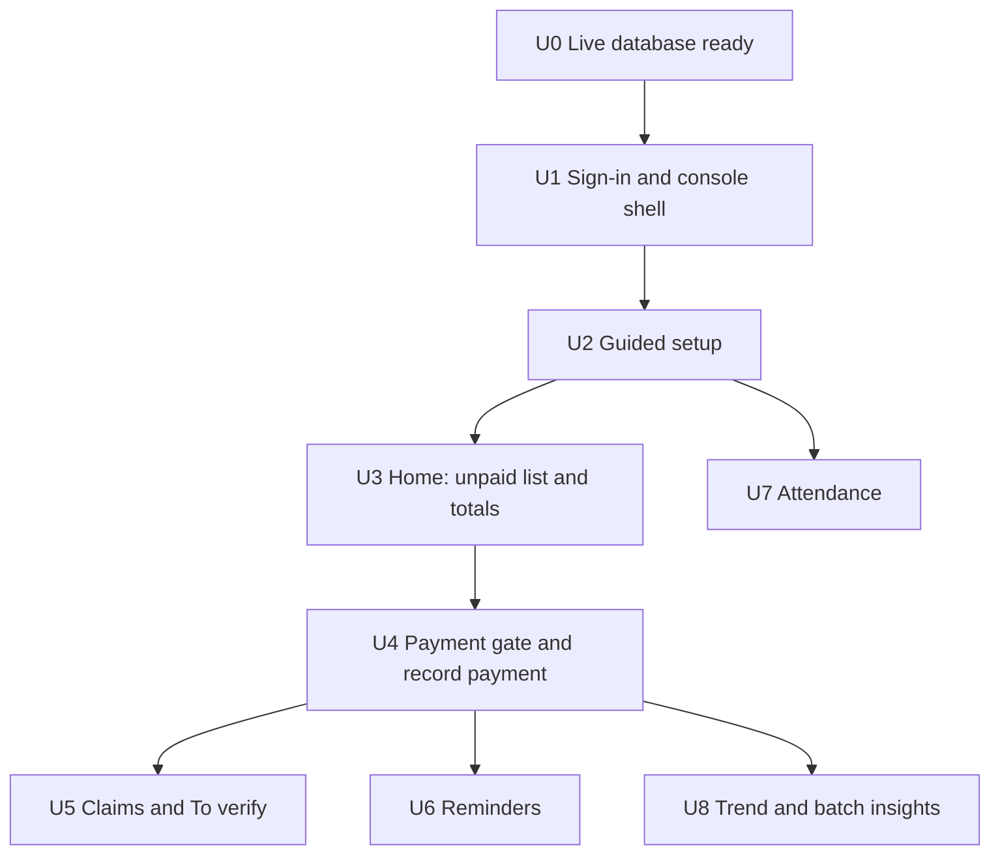

# Studio Owner Console - Plan

## Goal Capsule

- **Objective:** A studio owner signs in and, from one screen, sees who has not paid and how much money is missing this month, then acts on it: records or verifies a payment, or sends a reminder.
- **Product authority:** The user, in conversation on 2026-10-16. The three Key Decisions labeled session-settled below bind this plan.
- **Active scope:** The owner-facing console only. The student and family portal (student accounts, classes across studios, attendance percentage) and the cover page with the demo video are not active scope; they follow as separate brainstorms.
- **Open blockers:** None.

## Product Contract

### Summary

The owner gets a sign-in page and a console that opens on "who hasn't paid": unpaid students with amount and days overdue, a Remind button on each, and a Record payment button. Month totals of billed, collected and missing sit above the list. A payment gate checks every reported payment against what the student owes before it reaches the ledger. The console also covers fee plans, batches, students, attendance and a log of sent reminders, and a guided checklist takes a new owner from an empty studio to their first month. It is built and tested one slice at a time.

### Problem Frame

The money, attendance and reminder rules already exist in the backend, but after signing in an owner sees only profile fields and plan cards. They cannot see who owes what, how much is missing, or act on it, so the app cannot replace the notebook or spreadsheet they use today.

Payments reach a studio in loose forms: cash in hand, a UPI transfer, a screenshot sent on WhatsApp. Recording whatever a guardian says they paid, without checking it against what is owed and against the studio's own bank or UPI statement, puts wrong numbers in the ledger.

### Actors

- A1. Studio owner: signs in, sets up the studio, runs the month.
- A2. Guardian: pays the fee and, through their private family link, may report that they paid.

### Key Decisions

- **Student fees stay ledger-only.** ChoreoStudio records charges and the payments the studio confirms; it never moves student money. Governs R10, R11, R12. (session-settled: user-directed — chosen over processing student payments through Dodo or a UPI gateway: payment processing is out of scope and compliance-heavy.)
- **Plan and billing state stay server-managed.** The console shows plan and billing status but never lets an owner change them. Governs R2. (session-settled: user-directed — chosen over letting authenticated users update billing columns: an account must not self-assign plan or payment state.)
- **Waitlist owner access stays in a separate role table.** The console does not use client-side email checks to decide who sees the waitlist. Governs R2. (session-settled: user-directed — chosen over client-side identity checks: signup records must not be exposed that way.)
- **The home screen opens on the unpaid list, then the money totals.** The owner's first act on the day after fees are due is to chase unpaid students, so that is the first thing shown. Governs R4, R5.
- **Reminders are sent by the owner's click, never on a schedule.** The owner sees who will be messaged before anything goes out. Automatic reminders are an opt-in setting later. Governs R14.
- **Setup is guided and one record at a time.** Spreadsheet import is deferred. Governs R3. (session-settled: user-directed — chosen over spreadsheet import first: simplest to build and test.)
- **A reported payment is a claim until the owner confirms it.** Only a confirmed claim becomes a ledger payment, and the owner's own bank or UPI statement, matched by reference number, is the source of truth rather than a screenshot. Governs R10, R11, R12. (session-settled: user-approved — chosen over recording what the guardian says as paid: the agent proposed the gate after the user asked for a check that the amount matches what is owed.)
- **A screenshot is optional supporting evidence, not proof.** Amount and, for UPI or bank payments, the reference number are required; a screenshot is optional. Collecting it needs a clear notice to the guardian and it is deleted once the claim is decided. Governs R12, R13.

### Requirements

**Access and setup**

- R1. An owner can create an account and sign in with email and password or with Google, and can reset a forgotten password, from a dedicated sign-in page.
- R2. After sign-in the owner lands in the console, which shows their plan and billing status read-only and shows the waitlist only to the platform owner role.
- R3. A new owner sees a setup checklist (fee plans, batches, students with guardian and phone, assigning plans) with each step's completion shown, and can leave and resume it.

**Home: money and who to chase**

- R4. The home screen lists every unpaid student for the selected month with amount owed, due date and days overdue, sorted by oldest overdue first.
- R5. The home screen shows, for the selected month, the amount billed, collected and missing, with missing split into overdue and not yet due and overdue as the headline.
- R6. Home shows the number of ongoing batches, the number of students, and how many have paid.
- R7. Each unpaid row has Record payment and Remind actions without leaving the list.

**Studio records**

- R8. The owner can create, edit and archive fee plans, batches (weekdays, time, trainer, room) and students with a guardian, and can put a student on a batch roster and assign a student a fee plan separately from the roster.
- R9. The owner can mark attendance for a batch on a class date and see each student's attendance percentage and the classes held per batch for a month.

**Payments and the verification gate**

- R10. Every payment the owner records or confirms is compared with what the student owes. An exact match confirms in one step. A part payment shows how much is still owed. A larger amount shows the excess and needs the owner to acknowledge it before it saves.
- R11. A payment can carry a date and a method (cash, UPI, bank), and the console shows each payment's date next to the charge it settled.
- R12. A guardian can report a payment from their family link by entering the amount and, for UPI or bank, the reference number, with an optional screenshot. The report waits in a To verify list and changes no balance until the owner confirms it.
- R13. In To verify the owner sees the claimed amount beside the amount owed and can confirm, adjust the amount, or reject with a reason. A reference number already used on another payment is flagged as a possible duplicate.
- R14. The owner can send a fee reminder to one student or to all overdue students after seeing the recipient list, and sees a log of what was sent, to whom, and whether it was delivered or failed.
- R15. The console shows, month by month, billed against collected and missing, so the owner can see the trend.

### Key Flows

- F1. First day
  - **Trigger:** A new owner finishes sign-up.
  - **Actors:** A1
  - **Steps:** Open the checklist, add a fee plan, a batch and students with guardians, assign plans, generate the month's charges, land on Home.
  - **Outcome:** Home shows a real unpaid list.
  - **Covered by:** R1, R3, R8, R4

- F2. The day after fees are due
  - **Trigger:** The owner opens Home on the 6th.
  - **Actors:** A1
  - **Steps:** Read the missing total, scan the unpaid list oldest first, record a cash payment for one student, send reminders to the rest after reviewing the list.
  - **Outcome:** Balances update and the sent log shows the reminders.
  - **Covered by:** R4, R5, R7, R10, R14

- F3. A guardian says they paid by UPI
  - **Trigger:** A guardian submits amount, reference number and optionally a screenshot from their family link.
  - **Actors:** A1, A2
  - **Steps:** The claim appears in To verify; the owner checks the amount against what is owed and the reference number against their own UPI or bank statement; confirms, adjusts or rejects.
  - **Outcome:** A confirmed claim becomes a ledger payment and the unpaid list shrinks; a rejected one is recorded with its reason and changes nothing.
  - **Covered by:** R10, R12, R13

### Acceptance Examples

- AE1. **Covers R10.** Given a student owes 1,500 for October, when the owner confirms a 1,500 payment, then it saves in one step and the student leaves the unpaid list.
- AE2. **Covers R10.** Given a student owes 1,500, when the owner confirms 1,000, then the screen shows 500 still owed and the student stays on the list with the reduced amount.
- AE3. **Covers R10.** Given a student owes 1,500, when a 2,000 payment is entered, then the screen shows 500 excess and will not save until the owner acknowledges it.
- AE4. **Covers R12, R13.** Given a guardian submits a claim for 1,500, when it is waiting in To verify, then the student's balance and the money totals are unchanged until the owner confirms it.
- AE5. **Covers R13.** Given a reference number was used on a confirmed payment, when a new claim arrives with the same number, then it is flagged as a possible duplicate.
- AE6. **Covers R5.** Given three students owe 1,500 and one of them is past due, when the owner opens Home, then missing shows 4,500 with overdue 1,500 as the headline.

### Success Criteria

- A new owner reaches a populated Home without help.
- On the day after fees are due, the owner can name how much money is missing and who owes it within one screen, and can act on any row without leaving it.
- No payment reaches the ledger without the amount having been compared with what is owed.
- Each slice is shipped only after the user has tested it on the real app.

### Scope Boundaries

**Deferred for later**

- The student and family portal: student accounts, classes across studios, attendance percentage, monthly attendance and payments.
- The cover page rework and the demo video, recorded from the finished screens with an ElevenLabs voiceover.
- Spreadsheet import of students.
- Automatic scheduled reminders.
- Enforcing Starter, Growth and Studio plan limits in the console.
- An audit trail of who changed what.

**Outside this product's identity**

- Processing student payments, or holding student money.

### Dependencies / Assumptions

- The backend of `docs/plans/2026-10-16-1148-feat-studio-operations-backend-plan.md` is in place: ledger, attendance, reminders and family links.
- It does not yet store a payment claim, a reference number or a screenshot, report days overdue, or give a month-by-month trend; those are new.
- Sign-in with email, password and Google already works in `src/routes/account.tsx`; it moves to its own page.
- A guardian already has a private family link, so claims need no guardian account.
- The WhatsApp provider is not chosen; reminders stay queued until `WHATSAPP_PROVIDER_URL` and `WHATSAPP_PROVIDER_TOKEN` are set.
- The migrations `0003` to `0006` still have to be applied to the live database before any slice can be tested there.

### Legal and privacy notes (not legal advice)

- Collecting UPI screenshots is lawful, but a screenshot shows the payer's name, UPI ID, phone number and possibly bank details, so it is personal data. India's Digital Personal Data Protection Act 2023 applies; its rules were notified in November 2025 with notice, consent and safeguard duties starting around May 2027. Building to them now is cheaper than retrofitting: a notice at upload, collect only what is needed, store privately, delete after the claim is decided. ([Hogan Lovells](https://ca.hoganlovells.com/en/publications/indias-digital-personal-data-protection-act-2023-brought-into-force-), [JSA](https://www.jsalaw.com/?p=55573))
- A screenshot is weak evidence: it can be edited, and under Section 63 of the Bharatiya Sakshya Adhiniyam 2023 a copy of an electronic record needs a certificate to be admissible in court. This is why the owner's own bank or UPI statement, matched by reference number, is the source of truth. ([iPleaders](https://blog.ipleaders.in/electronic-evidence-under-the-bsa-2023/), [Legal Service India](https://www.legalserviceindia.com/Legal-Articles/?p=30944))
- A short review by a lawyer is advisable before real guardians' screenshots are collected.

### Outstanding Questions

**Deferred to Planning**

- How long a decided claim's screenshot is kept before deletion, and how deletion is guaranteed.
- Whether "days overdue" should allow a grace period (planned without one).
- Whether claims from the family link need a rate limit or a check against spam, since the link is unauthenticated.

### How This Work Fits Together

<!-- ce-section: work-relationships -->

This plan covers the studio owner console. The breakdown below is the current understanding, not a committed roadmap.

- Studio owner console (this plan)
  - Student and family portal: Depends on this plan's payment claims and family-link page; Still to decide how a student account links to a studio's records and to several studios.
  - Cover page and demo video: Depends on the finished console screens for the recording; Can proceed independently of the portal.

---

## Planning Contract

**Product Contract preservation:** Product Contract unchanged; every R, A, F and AE ID keeps its meaning.

### Key Technical Decisions

- KTD1. **Console routes live under `/app`, with sign-in at `/login`.** `/app` is a layout route with child routes for Home, setup, students, batches, fee plans, billing, attendance, messages and verify. The sign-in page replaces the form inside `src/routes/account.tsx`, which keeps profile and plans. Authorization is still enforced by the server functions' auth middleware; the client redirect to `/login` is a convenience. Serves R1, R2.
- KTD2. **Screens read through React Query over the existing server functions.** `@tanstack/react-query` is already installed and provided in `src/routes/__root.tsx`; each screen wraps a server function with `useServerFn` the way `src/routes/admin.tsx` does. Money is stored and moved as whole paise and formatted for display by one shared helper.
- KTD3. **Reporting and the payment gate are SQL functions, not TypeScript.** Unpaid list with days overdue, monthly trend, studio snapshot and the amount-versus-owed comparison are new invoker functions beside `student_ledger_status`, so the owner's numbers, the family view and the gate cannot disagree. Serves R4, R5, R6, R10, R15.
- KTD4. **The gate lives inside `record_payment` and the claim-confirm function.** Both call one comparison that returns owed, remaining and excess, and refuse an excess unless the caller passes an acknowledgment flag. The existing six-argument `record_payment` is dropped and recreated with two defaulted arguments (`reference`, `acknowledge_excess`), so callers that pass six arguments still work. Existing ledger tests that overpay are updated to acknowledge. Serves R10, R13.
- KTD5. **A claim is its own record and never touches the ledger until confirmed.** A `payment_claims` table holds amount, method, reference number, optional screenshot path, status (pending, confirmed, rejected), decision reason and the payment it became. Confirming runs through the same idempotent payment path using the claim id as the idempotency key. Serves R12, R13.
- KTD6. **Duplicate references are flagged, not silently blocked.** A reference number found on a live payment or on another pending claim marks the claim "possible duplicate" in the review screen; the owner decides. Serves R13.
- KTD7. **Claims arrive through a public server function authorized by the family token.** It reuses the token hashing in `src/lib/family.server.ts`, limits each guardian to five pending claims, and accepts only a student that belongs to that guardian. It is rate-limited in SQL, not in the browser. Serves R12.
- KTD8. **Screenshots go to a private storage bucket the browser cannot read.** The guardian uploads through a signed upload URL issued after the token check; the owner views through a short-lived signed URL; the file is deleted when the claim is decided, with a purge job for undecided claims older than 30 days as a backstop. Allowed types are PNG, JPEG and WebP up to 5 MB. Serves R12 and the privacy notes.
- KTD9. **The setup checklist is derived from data, not stored.** Each step is complete when the matching rows exist (fee plan, batch, student, assignment, generated charges), so it cannot drift and needs no table. Serves R3.
- KTD10. **Reminders are queued by the owner's click and delivered by the existing job.** Add an optional student filter to the queue function and a preview that lists recipients, amounts and opt-outs before anything is queued. The console shows queued, sent and failed honestly; while no WhatsApp provider is configured it says reminders are queued, not sent. Serves R14.
- KTD11. **Layouts work on a phone first.** Owners check dues on mobile in the studio; every console screen is usable at 375 px width, and the unpaid list collapses to cards. Serves R4, R7.

### Assumptions

- Days overdue counts calendar days from the due date in India time, with no grace period (Outstanding Question on grace is resolved this way until the user says otherwise).
- "Classes in each batch" shows scheduled sessions in the month, counted from the batch weekdays, beside sessions actually held, counted from attendance records.
- "Date of payment" next to a charge is the date of the payment that completed it, found by applying payments oldest charge first, as the ledger already does.
- Supabase storage can host a private bucket on the Lovable Cloud project; this is checked in U0 before U5 depends on it.
- The live database is the only place the user can test, so migrations are applied there with the user's approval before the first slice is tested.

### Sequencing and test gates

Work proceeds one unit at a time. After each unit the work stops, the unit's test gate is handed to the user as a short checklist of what to click and what should happen, and the next unit starts only after the user says it passes. This overrides the usual run-to-completion flow.

---

## Implementation Units

| U-ID | Title | Key files | Depends on |
|---|---|---|---|
| U0 | Live database ready | `drizzle/migrations/0003`-`0006`, `drizzle/verify/rollout-checks.sql` | none |
| U1 | Sign-in and console shell | `src/routes/login.tsx`, `src/routes/app.tsx` | U0 |
| U2 | Guided setup | `src/routes/app.setup.tsx`, `src/routes/app.plans.tsx` | U1 |
| U3 | Home | `drizzle/migrations/0007_console_reports.sql`, `src/routes/app.index.tsx` | U2 |
| U4 | Payment gate and record payment | `drizzle/migrations/0008_payment_gate.sql`, `src/routes/app.billing.tsx` | U3 |
| U5 | Claims and To verify | `drizzle/migrations/0009_payment_claims.sql`, `src/routes/family.$token.tsx` | U4 |
| U6 | Reminders | `src/routes/app.messages.tsx` | U4 |
| U7 | Attendance | `src/routes/app.attendance.tsx` | U2 |
| U8 | Trend and batch insights | `src/routes/app.insights.tsx` | U4 |

### U0. Live database ready

**Goal:** The user can test every later slice against the real database.

**Requirements:** Enables all.

**Files:**
- Apply: `drizzle/migrations/0003_studio_directory.sql` to `0006_apply_billing_event.sql`
- Run: `drizzle/verify/rollout-checks.sql`

**Approach:**
- Review the four migrations against the three original tables once more, then apply them to the live database through the Lovable database tool in order, with the user's go-ahead before each apply.
- Run the rollout checks against the live database; it must return no rows.
- Confirm a private storage bucket can be created there; record the answer for U5.

**Test scenarios:**
- The rollout checks return no rows after the apply.
- A signed-in owner can read an empty `students` list and cannot read another studio's rows.

**Verification:** Rollout checks clean on the live database. **User test gate:** none beyond approving the apply.

### U1. Sign-in and console shell

**Goal:** An owner can create an account, sign in with email or Google, reset a password, and land in an empty console frame with navigation. Advances R1, R2.

**Dependencies:** U0

**Files:**
- Create: `src/routes/login.tsx`, `src/routes/app.tsx`, `src/routes/app.index.tsx`, `src/hooks/use-owner.ts`, `src/lib/console.functions.ts`, `src/lib/console.server.ts`, `src/lib/money.ts`
- Modify: `src/routes/account.tsx`, `src/styles.css`
- Test: `src/test/money.test.ts`, `src/test/console.server.test.ts`

**Approach:**
- Move the existing sign-in, register, forgot-password and Google handlers out of `src/routes/account.tsx` into `src/routes/login.tsx` unchanged in behavior; `/account` links to the console.
- `src/routes/app.tsx` renders the left navigation from the mock (Overview, Students, Batches, Billing, Attendance, Fee plans, Messages) with a mobile menu, redirects to `/login` when there is no session, and shows plan and billing status read-only.
- A console-context server function ensures the studio profile exists and returns plan, billing status and whether the caller holds the platform owner role, so the waitlist link renders only for that role.
- `src/lib/money.ts` formats paise as rupees with Indian grouping.

**Patterns to follow:** `src/routes/admin.tsx` for `useServerFn` and session handling; `src/lib/profile.functions.ts` for validators.

**Test scenarios:**
- Money formatting: 150000 paise renders as ₹1,500, 12345600 as ₹1,23,456, a half-rupee keeps two decimals.
- The console-context function creates a profile for a first-time owner and returns `not_started` and `waitlist`.
- It reports the platform owner role only when the role table says so, not from an email string.

**Verification:** Typecheck, tests, build. **User test gate:** Register with email, confirm, sign in; sign out and sign in with Google; use forgot-password; land on an empty Home with the navigation, which works on a phone-width window; plan card shows read-only.

### U2. Guided setup

**Goal:** A new owner goes from an empty studio to a studio with fee plans, batches, students and assigned plans, guided by a checklist. Advances R3, R8.

**Dependencies:** U1

**Files:**
- Create: `src/routes/app.setup.tsx`, `src/routes/app.plans.tsx`, `src/routes/app.batches.tsx`, `src/routes/app.students.tsx`, `src/components/console/` (checklist, forms, table helpers)
- Test: `src/test/setup-progress.test.ts`

**Approach:**
- Screens call the existing functions in `src/lib/fees.functions.ts`, `batches.functions.ts` and `directory.functions.ts`; no new backend beyond a counts function that powers the checklist (KTD9).
- Students screen: add a student with guardian name and phone, put them on batches, assign a fee plan with a start date; archive instead of delete.
- Phone numbers are validated in the form with the same rule the database enforces and the error is shown beside the field.

**Test scenarios:**
- Checklist progress: each step flips complete only when its rows exist, and an archived-only studio counts as incomplete.
- A student cannot be saved without a name; an invalid phone shows an inline error.
- Assigning a plan does not change batch membership, and the reverse (R8).

**Verification:** Typecheck, tests, build. **User test gate:** Create two fee plans, two batches and five students with guardians; watch the checklist tick; archive one student; refresh and confirm nothing is lost; try an invalid phone.

### U3. Home: who hasn't paid and money missing

**Goal:** The home screen shows the unpaid list with days overdue and the month's billed, collected and missing. Advances R4, R5, R6.

**Dependencies:** U2

**Files:**
- Create: `drizzle/migrations/0007_console_reports.sql`, `src/lib/reports.functions.ts`, `src/lib/reports.server.ts`, `src/components/console/unpaid-list.tsx`
- Modify: `src/routes/app.index.tsx`, `drizzle/migrations/meta/_journal.json`, `src/integrations/supabase/types.ts`
- Test: `src/test/db/reports.test.ts`, `src/test/reports.server.test.ts`

**Approach:**
- Add `unpaid_students(period, today)` returning, per student with outstanding money, the amount owed, the oldest unpaid due date, days overdue, guardian name and phone, built on `student_ledger_status`.
- Add `studio_snapshot(period, today)` returning billed, collected, missing overdue, missing not yet due, student count, paid count and ongoing batch count.
- A month picker defaults to the current India month; "Generate charges" appears when the month has none.
- Rows keep Record payment and Remind buttons as placeholders disabled until U4 and U6 (Remind never hidden).

**Test scenarios:**
- Covers AE6. Three students owe 1,500 and one is past due: missing 4,500, overdue 1,500 headline.
- Days overdue counts from the due date in India time and is zero on the due date.
- A fully paid student and a voided charge never appear in the unpaid list.
- A student's credit (overpaid) does not reduce another student's amount.
- Another studio's students never appear.

**Verification:** Typecheck, DB tests, build; rollout checks still clean. **User test gate:** With the U2 students, generate October charges, see the list and totals match a hand count, change the due date and see days overdue change.

### U4. Payment gate and record payment

**Goal:** Recording a payment compares it with what is owed and handles part, exact and excess amounts. Advances R10, R11.

**Dependencies:** U3

**Files:**
- Create: `drizzle/migrations/0008_payment_gate.sql`, `src/components/console/record-payment.tsx`, `src/routes/app.billing.tsx`
- Modify: `src/lib/ledger.functions.ts`, `src/lib/ledger.server.ts`, `src/lib/schemas.ts`, `src/test/db/ledger.test.ts`, `src/test/ledger.server.test.ts`
- Test: `src/test/db/payment-gate.test.ts`

**Approach:**
- Add a nullable `reference` column to `payments`; add `payment_check(student, amount)` returning owed, remaining and excess; recreate `record_payment` per KTD4.
- The Record payment dialog shows owed, the entered amount and the result (settles it, X still owed, or X excess needing a tick) before saving.
- The Billing screen lists a student's charges with allocated amount, the settling payment's date and method, and lets the owner void a payment or charge with a reason.
- Update existing ledger tests that overpay to pass the acknowledgment.

**Test scenarios:**
- Covers AE1. Exact amount saves in one step and clears the student from the unpaid list.
- Covers AE2. A part payment leaves the remaining amount owed and the student listed.
- Covers AE3. An excess without acknowledgment is refused by the database; with it, it saves and shows as credit.
- A repeated idempotency key returns the original payment, including when the reference matches.
- Payments cannot be recorded for another studio's student.

**Verification:** Typecheck, DB tests, build. **User test gate:** Record one exact, one part and one excess payment; confirm each result on screen and in the unpaid list; void one and see the balance return.

### U5. Claims and To verify

**Goal:** A guardian can report a payment from the family link and the owner can verify it against what is owed. Advances R12, R13.

**Dependencies:** U4

**Files:**
- Create: `drizzle/migrations/0009_payment_claims.sql`, `src/lib/claims.functions.ts`, `src/lib/claims.server.ts`, `src/routes/family.$token.tsx`, `src/routes/app.verify.tsx`, `src/lib/job-purge-screenshots.server.ts`, `src/routes/api/jobs/purge-screenshots.ts`
- Modify: `src/lib/family.server.ts`, `.env.example`, `README.md`
- Test: `src/test/db/claims.test.ts`, `src/test/claims.server.test.ts`

**Approach:**
- The family page shows the balance from the existing family view and an "I've paid" form with amount, method, reference number (required for UPI and bank), paid date, optional screenshot and a short privacy notice (what is collected, why, that it is deleted once the owner decides).
- `submit_payment_claim` (service role) validates the token's guardian owns the student, applies the five-pending limit and stores the claim; the screenshot uploads through a signed URL (KTD8).
- To verify lists pending claims with claimed amount beside owed, a duplicate-reference flag, and a link to a short-lived screenshot view; Confirm calls the gate, Adjust changes the amount first, Reject needs a reason.
- Deciding a claim deletes its screenshot; the purge job removes screenshots of claims pending over 30 days and is guarded by the same bearer secret as the reminder job.

**Test scenarios:**
- Covers AE4. A pending claim changes no balance or total.
- Covers AE5. A reference already on a live payment or another pending claim is flagged.
- A token for guardian A cannot claim for guardian B's student; a revoked or malformed token is refused with the generic answer.
- A sixth pending claim from one guardian is refused.
- Confirming twice records one payment (idempotent); an excess needs acknowledgment; rejecting needs a reason and changes nothing.
- A rejected claim's reference can be reused by a genuine later claim.
- Wrong file type or size over 5 MB is refused; the screenshot is gone after the decision.
- Another studio's owner cannot read or decide this studio's claims.

**Verification:** Typecheck, DB tests, build, bundle-secret scan. **User test gate:** From a guardian's link submit a claim (exact, then part), with and without a screenshot; verify as owner, including a duplicate reference and a rejection; confirm the screenshot disappears and balances are right. A lawyer's review of the privacy notice is recommended before real guardians use it.

### U6. Reminders

**Goal:** The owner reviews recipients and sends reminders to one student or all overdue, and sees the sent log. Advances R14.

**Dependencies:** U4

**Files:**
- Create: `drizzle/migrations/0010_reminder_preview.sql`, `src/routes/app.messages.tsx`
- Modify: `src/lib/reminders.functions.ts`, `src/lib/reminders.server.ts`, `src/routes/app.index.tsx`
- Test: `src/test/db/reminder-preview.test.ts`, `src/test/reminders.server.test.ts`

**Approach:**
- Add an optional student filter to the queue function and a preview function returning recipient, phone, amount and whether the guardian opted out or has no usable number.
- Remind opens a confirmation listing exactly who will be messaged; confirming queues them. Messages shows each reminder's status, attempts and last error.
- When no provider is configured the screen says reminders are queued and not yet sent.

**Test scenarios:**
- Queueing one student queues only that student; "all overdue" excludes paid, not-yet-due, opted-out and no-phone students and the preview lists them with reasons.
- Queueing twice the same day creates one reminder per charge.
- Another studio's students are never previewed or queued.

**Verification:** Typecheck, DB tests, build. **User test gate:** Preview and queue one reminder and all overdue; confirm the list matches Home; see queued status; if a provider is configured, confirm delivery.

### U7. Attendance

**Goal:** The owner marks attendance for a batch on a class date and sees attendance percentage. Advances R9.

**Dependencies:** U2

**Files:**
- Create: `src/routes/app.attendance.tsx`
- Modify: `src/routes/app.batches.tsx`
- Test: `src/test/attendance-ui.test.ts`

**Approach:**
- Uses the existing mark-attendance, batch-day and student-attendance functions: pick batch and date, tick present or absent for the roster, save once.
- Student rows show attendance percentage over a selectable range and classes held per batch for the month.

**Test scenarios:**
- Percentage is present marks over marked sessions in range, and a student with no marks shows no percentage rather than 0%.
- A student not on the roster cannot be marked; a date outside the allowed window shows the database's message.

**Verification:** Typecheck, tests, build. **User test gate:** Mark a class for two batches on two dates, change a mark, see percentages update, try a student not on the roster.

### U8. Trend and batch insights

**Goal:** Month-by-month billed against collected and missing, and classes per batch. Advances R15.

**Dependencies:** U4

**Files:**
- Create: `drizzle/migrations/0011_monthly_trend.sql`, `src/routes/app.insights.tsx`
- Test: `src/test/db/monthly-trend.test.ts`

**Approach:**
- Add `monthly_trend(months)` returning billed, collected and missing per charge month for the last six months, built on `student_ledger_status`; render with the installed `recharts` and a table fallback for screen readers.
- Show batch cards with scheduled and held sessions for the month and student counts.

**Test scenarios:**
- A month with no charges shows zeros, not a gap.
- A payment made in a later month counts as collected for the charge month it settled.
- A voided charge or payment is excluded.

**Verification:** Typecheck, DB tests, build. **User test gate:** Generate two months of charges, pay some, and confirm the chart and the table agree with Home.

---

## Verification Contract

| Gate | Command | Applies to |
|---|---|---|
| Types | `node node_modules/typescript/bin/tsc --noEmit -p .` (not `npx tsc`, which is a stub here) | All units |
| Tests | `npx vitest run` | All units |
| Build | `npm run build` | All units |
| Lint on touched files | `npx eslint <changed files>` (whole-repo lint already fails on untouched files) | All units |
| Rollout checks | `drizzle/verify/rollout-checks.sql`, extended in U3, U4, U5 for new tables and functions | U0, U3-U6, U8 |
| Client bundle scan | `src/test/bundle-secrets.test.ts` after a build | U1, U5 |
| User acceptance | The unit's test gate, run by the user on the real app | Every unit before the next starts |

## Definition of Done

- Every unit's test scenarios exist and pass, and every R-ID from R1 to R15 is exercised by at least one test or user test gate.
- Types, tests and build pass on the final tree and the rollout checks are clean on the live database.
- The user has passed every unit's test gate.
- No `.env`, key or secret is committed and no pushed history was rewritten.
- Abandoned-attempt code is removed from the diff.
- Anything not done is listed in the final report.

## Risks & Dependencies

- The privacy notice and screenshot handling have not had legal review; the DPDP Act's core duties begin around May 2027, but the notice and deletion are built in from the start.
- Private storage on the Lovable Cloud project is unverified until U0.
- The family-link claim form is unauthenticated, so the five-pending limit and token check are the only abuse controls; revisit if spam appears.
- Recreating `record_payment` changes a function the backend tests already cover; those tests are updated in U4.
- Reminders do not reach guardians until a WhatsApp provider is configured and the scheduler calls the job.
