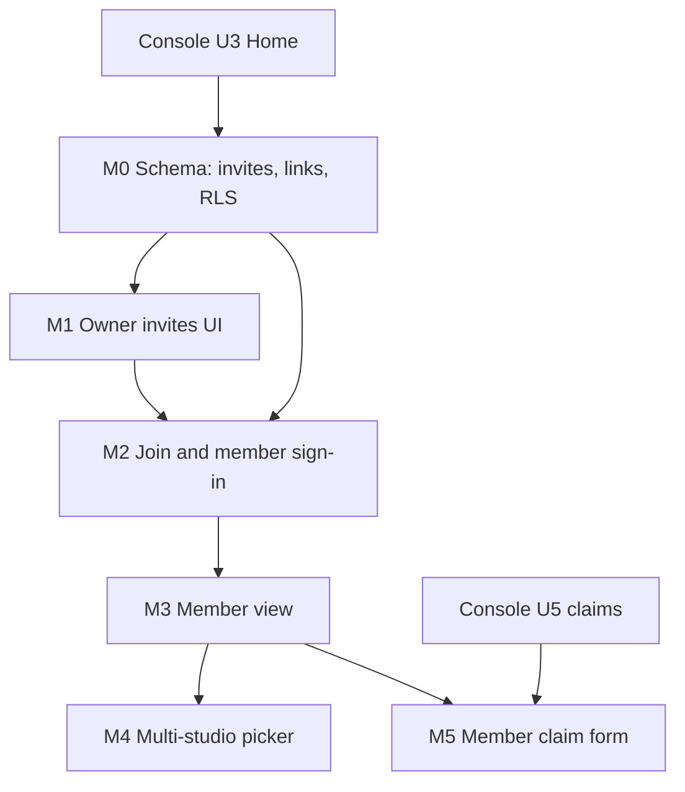

# Member Portal - Plan

## Goal Capsule

- **Objective:** A dancer enrolled at a studio redeems an invite from the studio owner, signs in with their own account, and sees only that studio's records about them: classes, attendance, charges, payments and balance. They can report a payment (the claim form from owner-console unit U5) from the same place.
- **Product authority:** The user's brief of 2026-10-16. Standing rules from the handoff bind this plan: fees are ledger-only, `plan`/`billing_status` are server-managed, the waitlist owner role stays in `user_roles`, no pushed history is rewritten, no migration is applied and nothing is pushed without the user's go-ahead.
- **Active scope:** The dancer login, invites, the dancer's read-only view, membership in several studios, row-level security, and the claim-a-payment form. All dancers are adults (user decision, 2026-10-17): there are no separate guardians, and each dancer is their own contact. The owner console (U1 to U8) is not changed except where this plan names a seam.
- **Status:** Approved by the user, 2026-10-16. Built 2026-10-18 as migration 0016 (not applied); see docs/handoff/2026-10-18-member-portal-handoff.md for the deliberate differences.

## Product Contract

### Summary

The owner generates an invite for a dancer from the console. It is a link plus a short code, valid for 7 days, single use, revocable. The dancer opens it, signs in with a Google account or an email magic link (or creates an account), and the invite attaches their account to their own record at that one studio. From then on they open `/me`, see the studios they belong to, and inside each only their own data. The existing private family link keeps working as a zero-signup, read-only view.

### Problem Frame

Today a dancer can only be reached through the private family link (`src/lib/family.server.ts`): a bearer token, no identity, read through the service role. That is right for "check the balance from a WhatsApp message", but it cannot hold a person across several studios, cannot be revoked per device, cannot safely carry a payment-claim form beyond the five-pending limit, and gives the studio no way to know who actually opened it. Dancers also lose links; a login with Google or email recovers itself.

Under the hood each dancer is one `guardians` row plus one `students` row with the same name and phone (the console hides the split). The `guardians` row is per studio (`guardians.studio_id`) and has a phone but no email or user id. Nothing in the database connects a signed-in person to it; that link is what this plan adds.

### Actors

- A1. Studio owner: creates, lists, revokes invites; sees who has joined.
- A2. Dancer (member): an adult enrolled at a studio, who logs in for themselves. One account per person.
- A3. Platform: server functions with the service role (invite redemption only).

### Key Decisions

- **Members use accounts; the family link stays as a lighter second door.** The same Supabase auth project serves both, but members live in their own tables and routes and never get a studio profile. Recommended over account-only (loses the no-signup WhatsApp use that studios already have) and link-only (cannot support several studios, per-person revocation or a trustworthy claim form). Open question Q1.
- **Membership is a link table, not a role.** A `member_links` row ties one auth user to one `(studio_id, guardian_id)`. Access is derived from that row, so an account with no row sees nothing. Several rows for one user is multi-studio, with no migration later. Chosen over a global role (cannot say which studio) and over stuffing studio ids in auth metadata (user-editable or stale).
- **The invite is the only way to create a link.** Invites are bound by the owner to one dancer record, so the person never picks or claims a record. Chosen over self-serve "find me" (phone-number guessing exposes other dancers).
- **Invite = unguessable token plus a short code, single use, 7-day expiry, revocable.** The code is for reading out over a phone or pasting into WhatsApp; the link is the same secret in URL form. Both store only a hash, as family links do.
- **Redeeming binds the invite to the signed-in account at the moment of redemption.** After that the invite is spent. The owner can revoke a membership later without deleting the dancer record.
- **A dancer's data is a fixed, narrow read.** The owner sees full tables; a dancer sees a defined set of fields about themselves only. A dancer never reads other dancers, other members, or any other studio's data.
- **Ledger-only holds.** The member portal shows balances and takes claims. It never charges anyone.

### Requirements

**Invites**

- R1. An owner can create an invite for a dancer from the console. The result (link and code) is shown once; afterwards only status is visible.
- R2. An invite expires 7 days after creation (owner may choose 1, 7 or 30), works once, and stops working when revoked or when the dancer is archived.
- R3. The owner can see, per dancer, whether they have a pending invite or have joined (and the join date), and nothing more (no last sign-in); can re-issue (which revokes the older pending invite) and can remove a joined dancer's access.
- R4. A used, expired, revoked or malformed invite gives one generic message and reveals nothing about the studio or dancer.
- R5. Invite creation is limited per dancer (five open invites at most) and redemption attempts are rate-limited.

**Sign-in and joining**

- R6. A member signs in with email (magic link or password, per the owner-login pattern) or Google, on a page separate from the owner login.
- R7. Redeeming an invite while signed in attaches the dancer's record to the account; while signed out, the invite is kept through sign-in or sign-up and redeemed on return.
- R8. A signed-in member who is also a studio owner keeps both identities; the member area never creates or changes a studio profile.
- R9. A member can belong to several studios (each redeemed with that studio's own invite) and picks one from a studio list; an account in one studio never reveals another studio's existence to a different studio.

**What a member sees**

- R10. A dancer sees their own batches (name, days, time, trainer, room), recent attendance, charges with status, payments, and balance, matching the owner's numbers because both use `student_ledger_status`.
- R11. A dancer sees the studio's name and nothing else about it. A dancer cannot see another dancer's data, other members, or any other studio's data.
- R12. The member area works at phone width and is readable on first load without the owner console's navigation.

**Claim a payment (from U5)**

- R13. A signed-in dancer can report a payment for themselves: amount, method, reference number (required for UPI and bank), paid date, optional screenshot, with the privacy notice from the console plan.
- R14. A claim is a claim: it waits in the owner's To verify list and changes no balance until the owner confirms (console plan R12, R13, AE4, AE5). Five pending claims per dancer, as the console plan sets.
- R15. A member can see their own claims and their status (pending, confirmed, rejected with the owner's reason) and cannot see other members' claims.

**Family link coexistence**

- R16. The existing family link keeps its read-only view. It no longer carries the claim form once a dancer has an account; claims from a link-only visitor remain possible under the console plan's rules (open question Q4).
- R17. A family-link page tells the dancer to ask their studio for a login invite; it never converts a link into an account (Q5).

### Key Flows

- F1. Owner invites a dancer
  - **Trigger:** Owner opens a dancer's row and chooses Invite.
  - **Steps:** pick expiry, create; copy link/code or send via the console's WhatsApp reminder channel later; row shows "Invited".
  - **Outcome:** a pending invite exists, shown once.
  - **Covered by:** R1, R2, R3
- F2. Dancer joins
  - **Trigger:** The dancer opens the link or enters the code on `/join`.
  - **Steps:** sign in or sign up (email or Google); invite is redeemed; land on `/me` with that studio open.
  - **Outcome:** membership exists; the owner's row shows "Joined".
  - **Covered by:** R4, R6, R7, R9
- F3. Second studio
  - **Trigger:** The same person receives an invite from another studio.
  - **Steps:** redeem while signed in; `/me` now lists two studios.
  - **Outcome:** two memberships, nothing shared between them.
  - **Covered by:** R9, R11
- F4. Member reports a payment
  - **Trigger:** The dancer opens their balance and taps "I've paid".
  - **Steps:** fill the claim form; see it as Pending; owner decides in To verify; member sees Confirmed or Rejected with reason.
  - **Outcome:** ledger changes only on owner confirmation.
  - **Covered by:** R13, R14, R15
- F5. Owner removes access
  - **Trigger:** A dancer leaves the studio or loses a phone.
  - **Steps:** owner revokes the membership; the member's next request returns nothing.
  - **Outcome:** access ends immediately; the dancer record and history stay.
  - **Covered by:** R3

### Acceptance Examples

- AE1. **Covers R2, R4.** Given an invite created 8 days ago with a 7-day expiry, when it is opened, then the generic "not valid, ask your studio" message appears and nothing about the studio is revealed.
- AE2. **Covers R2, R7.** Given a valid invite, when two different accounts try to redeem it, then the first succeeds and the second gets the generic message.
- AE3. **Covers R10, R11.** Given dancers A and B at the same studio, when A's account queries students, charges, payments or attendance, then only A's rows are returned, and B's ids return nothing.
- AE4. **Covers R9, R11.** Given one account that belongs to studios X and Y, when it queries X's data, then no Y row appears, and a different account in Y cannot read X.
- AE5. **Covers R3.** Given a joined member, when the owner removes their access, then the next request returns no rows and the old invite cannot be redeemed again.
- AE6. **Covers R8.** Given a member opens the member area, when they have no studio profile, then none is created.
- AE7. **Covers R14.** Given a member submits a claim of 1,500, when it is pending, then their balance and the studio totals are unchanged.
- AE8. **Covers R5.** Given six invite attempts with wrong codes from one source in a minute, when the sixth arrives, then it is refused with the generic message.

### Success Criteria

- A dancer can go from the owner's invite to seeing their own balance in under two minutes on a phone.
- No test or manual probe lets a dancer read another dancer's or another studio's data.
- The owner can always tell which dancers have joined, and can end any access in one click.
- The owner console is unaffected by member accounts existing in the same auth project.

### Scope Boundaries

**Deferred for later**

- Parents or guardians as separate people, and under-18 dancers (all dancers are adults by decision of 2026-10-17; revisit if that changes).
- Several logins per dancer.
- Push or WhatsApp notifications to members beyond the existing reminders.
- Members editing their own contact details.
- Online payment by members (outside the product's identity: ledger-only).
- Staff or trainer logins.

**Outside this product's identity**

- Processing student payments, or holding student money.

### Dependencies / Assumptions

- Owner console U1 (login shell) is done or in test; the member area is a separate route tree (`/me`, `/join`) so it does not depend on `/app`.
- The payment claims table and gate arrive in console units U4 and U5; this plan's claim form (R13 to R15) sequences after them.
- Supabase auth on the user's own project (`ngwvmuorxzahlfbktmum`) has email and Google providers on; to be confirmed for the Google redirect URL of `/join`.
- Migrations 0000 to 0007 are applied (0007 is `revoke_original_table_grants`). Owner-console U3 has already taken 0008 (`console_reports`), so this plan's migration takes the next free number at build time.
- A person at two studios is two dancer records (two `guardians` rows) that `member_links` joins to one account.

### Outstanding Questions

**Settled by the user, 2026-10-16**

- Q1. Accounts are the primary member door; the family link stays as a lighter read-only view.
- Q2. Members sign in with Google or email magic link (no passwords).
- Q3. Superseded 2026-10-17: all dancers are adults and log in for themselves; there are no separate guardians.
- Q4. A link-only visitor may still submit a claim, under the same five-pending cap shared with the account.

**Also settled**

- Q5. A dancer who uses a family link gets a login only through a fresh owner invite; the link never converts itself (R17 is only the text "Ask your studio for a login invite").
- Q6. The owner sees only joined or not (with join date), never last sign-in.

**Deferred to Planning**

- Exact code format and length (suggest 8 characters from an unambiguous set, grouped 4-4).
- Whether `/join` accepts the code on a typed form as well as the link (yes, planned).
- How a member's session is distinguished from an owner's on the shared sign-in page (see Planning Contract).

### How This Work Fits Together

<!-- ce-section: work-relationships -->

Tentative, not a roadmap. The owner console (separate plan) must reach U5 before the member claim form; invites and the read-only view can be built right after console U3 because they need only the ledger and dancer records. A later "staff logins" or "student own login" brainstorm would reuse `member_links`.

---

## Planning Contract

**Product Contract preservation:** Product Contract unchanged for review; IDs R1 to R17, AE1 to AE8 are the references below.

### Key Technical Decisions

- KTD1. **Two new tables, both server-managed.**
  `member_invites` (id, studio_id, guardian_id, token_hash unique, code_hash unique, expires_at, redeemed_at, redeemed_by, revoked_at, created_at; composite FK to `guardians (studio_id, id)` like `family_links`), and `member_links` (id, user_id → `auth.users`, studio_id, guardian_id, created_at, revoked_at; unique `(user_id, studio_id, guardian_id)`; composite FK to `guardians`). Revocation is `revoked_at`, never delete, and a trigger forbids un-revoking, copying the `guard_family_link_revoke` pattern in migration 0005. Serves R1 to R3, R9.
- KTD2. **Owner side uses invoker access under existing studio RLS; redemption uses a definer function.** Owners read and create `member_invites` and read/revoke `member_links` for their `studio_id = auth.uid()`, with column-level grants like `family_links`. Redemption is one `SECURITY DEFINER` function `redeem_member_invite(p_secret)` with `search_path = public`, which: hashes the secret, locks the invite row, checks unexpired, unredeemed, unrevoked and an unarchived guardian, inserts the link for `auth.uid()` and marks the invite redeemed in one transaction, and returns only the studio name. Every failure raises the same generic error. Serves R2, R4, R7, AE1, AE2.
- KTD3. **Member row-level security is a helper function, not repeated joins.** A `STABLE SECURITY DEFINER` function `is_member_of(p_studio uuid, p_guardian uuid)` (and `member_student_ids()` returning the students whose guardian the caller is linked to via an active `member_links` row) feeds new `SELECT` policies `TO authenticated` on the minimum tables: `students`, `batch_members`, `batches` (only via the member's students' memberships), `attendance_records`, `class_sessions`, `charges`, `payments`, `payment_claims`. Existing owner policies (`studio_id = auth.uid()`) stay as they are; policies are permissive and combine with OR, so the tests must prove the union grants no more than each side alone. Members get no INSERT/UPDATE/DELETE on any ledger table. Serves R10, R11, AE3, AE4.
- KTD4. **Fixed-shape member reads go through functions, not raw table access.** To avoid exposing columns the member does not need (e.g. `reminders_opted_out`, fee-plan assignment internals), the member screens call `member_view(p_studio)` returning the same fields as `getFamilyView` returns today. Raw-table member policies in KTD3 remain as defence in depth but the client never queries tables directly. `getFamilyView` is refactored so the family link and the member view share one query builder; the token path keeps using the service role scoped to its link, the member path uses the caller's JWT and RLS. Serves R10, R11, AE3.
- KTD5. **Members never get a studio profile.** `ensureStudio` in `src/lib/studio.server.ts` is called by `getConsoleContext` for any signed-in user. The member area uses its own middleware and its own context function that does not call it, and `/app` redirects a signed-in user who has memberships but no profile to `/me`. A sign-in page asks "I run a studio" or "I'm a student or guardian" up front; Google sign-in carries the choice in the redirect state. Serves R6, R8, AE6.
- KTD6. **One auth project, no custom role claims.** Which door a user may use is decided by the tables (`studio_profiles` row = owner, `member_links` rows = member), not by JWT claims, so an account can be both. The platform owner role in `user_roles` is untouched.
- KTD7. **Claims reuse the console plan's `payment_claims` table with a `submitted_via` and `member_link_id` column.** Link-token claims and member claims go through the same validation and the same five-pending limit counted per dancer, so a dancer cannot double the cap by using both doors. Members call a definer function `submit_payment_claim_member(...)` that derives guardian from `member_links` rather than trusting input. The screenshot upload reuses the console plan's signed upload URL (KTD8 there). Serves R13 to R15, AE7.
- KTD8. **Redemption path is rate-limited in SQL.** A small `invite_attempts` log keyed by hashed source (IP hash) and time, checked inside the redeem function; five failures per minute per source and twenty per hour. A code of 8 characters from a 31-letter set is about 40 bits, acceptable only with the throttle and the 7-day life. Serves R5, AE8.
- KTD9. **Routes:** `/join` and `/join/$secret` (public shells that complete after sign-in), `/me` (studio list), `/me/$studioId` (the member view), `/me/$studioId/claim`. Console side adds an Invite action and a status badge on the dancer row, and a Members section on the dancer page. Member routes are a separate layout from `src/routes/app.tsx`.
- KTD10. **Server code follows the repo pattern:** `*.functions.ts` thin wrappers with `requireSupabaseAuth`-style middleware (a new `requireMember` that rejects callers without an active link when a studio is named), logic in `*.server.ts` loaded by dynamic import, validators in `src/lib/validators.ts`. No service role in member requests except none: every member read runs on the caller's JWT so RLS is the real gate.

### Assumptions

- The dancer record (one `guardians` row, one `students` row, same name and phone) is the unit of identity at a studio.
- The owner supplies the invite through channels they already use (WhatsApp, in person). Sending it from the console is not part of this plan.
- Email deliverability for magic links is handled by the Supabase project's mail settings; custom SMTP is a separate setup task.

### Sequencing

As with the console, work proceeds one unit at a time and each unit ends at a user test gate. No migration is applied without the user's approval.

## Implementation Units

| U-ID | Title | Key files | Depends on |
|---|---|---|---|
| M0 | Schema, helpers and RLS | `drizzle/migrations/00NN_member_access.sql` (next free number at build; 0008 is already owner-console U3), `src/test/db/member-rls.test.ts` | console U3 |
| M1 | Owner invites | `src/lib/members.functions.ts`, `src/lib/members.server.ts`, console dancer row | M0 |
| M2 | Join and member sign-in | `src/routes/join.tsx`, `src/routes/join.$secret.tsx`, `src/routes/me.tsx` | M0, M1 |
| M3 | Member view | `src/routes/me.$studioId.tsx`, `src/lib/family.server.ts` (shared builder) | M2 |
| M4 | Multi-studio | `src/routes/me.index.tsx` | M3 |
| M5 | Claim a payment | `src/routes/me.$studioId.claim.tsx`, claims functions | M3 and console U5 |

### M0. Schema, helpers and RLS

**Goal:** the data model and the security boundary, proven by tests before any screen.

**Approach:** KTD1 to KTD3 and KTD8. The migration revokes default grants first (Supabase grants broadly to new tables), enables RLS on both new tables, and adds member `SELECT` policies listed in KTD3. Rollout checks in `drizzle/verify/rollout-checks.sql` are extended to flag any member-reachable table with an `INSERT`/`UPDATE`/`DELETE` grant or policy for a non-owner.

**Test scenarios (in-process Postgres, `src/test/db/`):**
- Covers AE3. Dancer A cannot read dancer B's student record, charges, payments, attendance or claims.
- Covers AE4. A user linked to studios X and Y reads each in isolation; a user linked to X cannot read Y.
- A user with no link reads zero rows from every table.
- A revoked link reads zero rows immediately.
- A member cannot insert, update or void a charge, payment, attendance row or claim except through the claim function.
- The owner's existing reads still return the whole studio; adding member policies does not widen owner or member access beyond each policy alone.
- Covers AE1, AE2, AE8. Redeem: expired, revoked, reused, malformed, archived-dancer and wrong-code cases give the same error text; the first of two concurrent redeems wins; throttle refuses the sixth failure.
- Another studio's owner cannot read or revoke this studio's invites or links.

**Verification:** types, DB tests, rollout checks. **User test gate:** the user approves the migration before apply; no screen yet.

### M1. Owner invites

**Goal:** the owner creates, lists and revokes invites and sees who joined. Advances R1 to R3, R5.

**Approach:** An Invite action on the dancer row opens a dialog (expiry choice, create), shows link and code once with copy buttons; the row shows Invited / Joined / No access. Re-issue revokes the older invite. A Members list shows joined guardians with a Remove access action.

**Test scenarios:** link and code shown once and absent from later list responses; re-issue invalidates the previous invite; remove access flips the link to revoked; another studio's dancer id is refused.

**User test gate:** invite a dancer, copy the code, see Invited; revoke it and see it die.

### M2. Join and member sign-in

**Goal:** a dancer opens the link, signs in, and is attached. Advances R4, R6 to R9.

**Approach:** `/join/$secret` stores the secret in session storage (never in a URL query after first load), routes through the member sign-in (Google or email magic link), then calls the redeem function. Typed-code form at `/join`. KTD5 keeps `ensureStudio` out of this path.

**Test scenarios:** redeem succeeds once; sign-in then redeem when the visitor started signed out; a signed-in owner redeeming keeps their studio profile intact and gets a membership; AE6 no studio profile created for a member-only account; generic error on every invalid state.

**User test gate:** open the link on a phone, sign in with Google and with email, land on `/me`; try the same link again and a wrong code.

### M3. Member view

**Goal:** the dancer sees their own classes, attendance, charges, payments and balance. Advances R10 to R12.

**Approach:** KTD4: shared view builder so the member and family link show identical numbers; member path on the caller's JWT.

**Test scenarios:** the numbers equal the family-link numbers for the same dancer; no field outside the fixed shape is returned; archived students are hidden; a dancer with no classes or charges yet sees an empty state.

**User test gate:** compare a member's screen with the owner's console for the same student, and with the family link.

### M4. Multi-studio

**Goal:** one account, several studios. Advances R9.

**Approach:** `/me` lists active memberships by studio name; the studio picker is skipped when there is one.

**Test scenarios:** two memberships list two studios; revoking one leaves the other; studio names are the only cross-studio data a user ever sees, and only for studios they belong to (AE4).

**User test gate:** redeem a second studio's invite with the same account.

### M5. Claim a payment

**Goal:** members report payments through the console plan's gate. Advances R13 to R15.

**Dependencies:** console U4 (payment gate) and U5 (`payment_claims`, screenshot storage). This unit adds the member door; U5 owns the table and the To verify screen.

**Test scenarios:** AE7 pending claim changes no balance; a member cannot claim for another dancer's record; one cap of five counts claims from the link and the account together; the member sees their own claims and the owner's rejection reason, not other members' claims; screenshots follow the console plan's type, size and deletion rules.

**User test gate:** submit exact and part claims as a member, decide them in To verify, and confirm the member sees the outcomes.

## Verification Contract

| Gate | Command | Applies to |
|---|---|---|
| Types | `node node_modules/typescript/bin/tsc --noEmit -p .` | All units |
| Tests | `npx vitest run` | All units |
| Build | `npm run build` | All units |
| Lint on touched files | `npx eslint <changed files>` | All units |
| Rollout checks | `drizzle/verify/rollout-checks.sql`, extended in M0 | M0 to M5 |
| Client bundle scan | `src/test/bundle-secrets.test.ts` after a build | M2, M5 |
| User acceptance | Each unit's gate, run on the real app before the next starts | Every unit |

## Definition of Done

- Every R and AE above is exercised by a test or a user test gate.
- Cross-member and cross-studio isolation is proven in `member-rls.test.ts`, including a case where one account holds both owner and member identities.
- Types, tests, build and rollout checks pass; the user has passed each gate.
- No secret committed, no pushed history rewritten, migrations applied only with the user's approval.

## Risks & Dependencies

- **Permissive policy union.** Adding member policies beside owner policies can widen access in ways neither policy alone suggests; M0 tests treat this as the main risk.
- **Owner and member in one account.** Owner code assumes `studio_id = auth.uid()`; a member-only account must never trigger `ensureStudio` (KTD5, AE6).
- **Short codes are guessable.** Safe only with the throttle and 7-day life; if rate limiting cannot run in SQL on the host, the code is dropped and only the long link is used.
- **A leaked invite link before redemption** gives the first redeemer access to that dancer's records. Mitigations: single use, expiry, owner sees "Joined" immediately and can remove access; an optional phone-number confirmation on redemption is a later hardening (Q6 area).
- **Personal data.** The portal exposes each adult dancer's own attendance and fee records to them only; DPDP Act duties apply as in the console plan's notes, and the lawyer review recommended there should cover this portal's notice too.
- **Sequencing on the console.** The claim form (M5) needs console U4 and U5; the rest does not.
